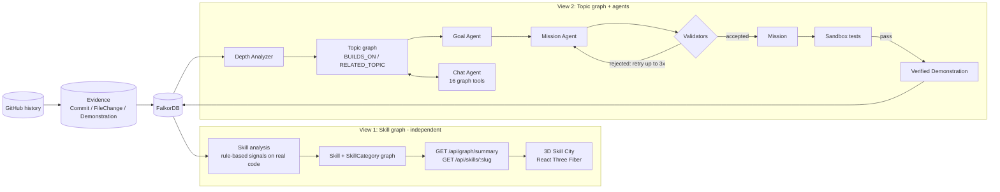
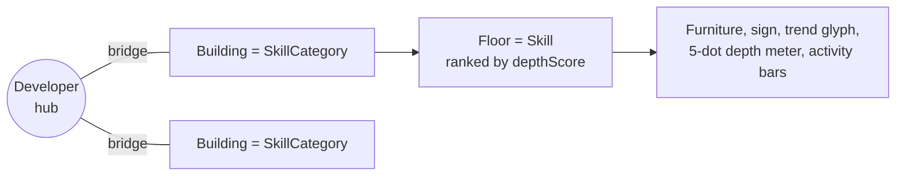
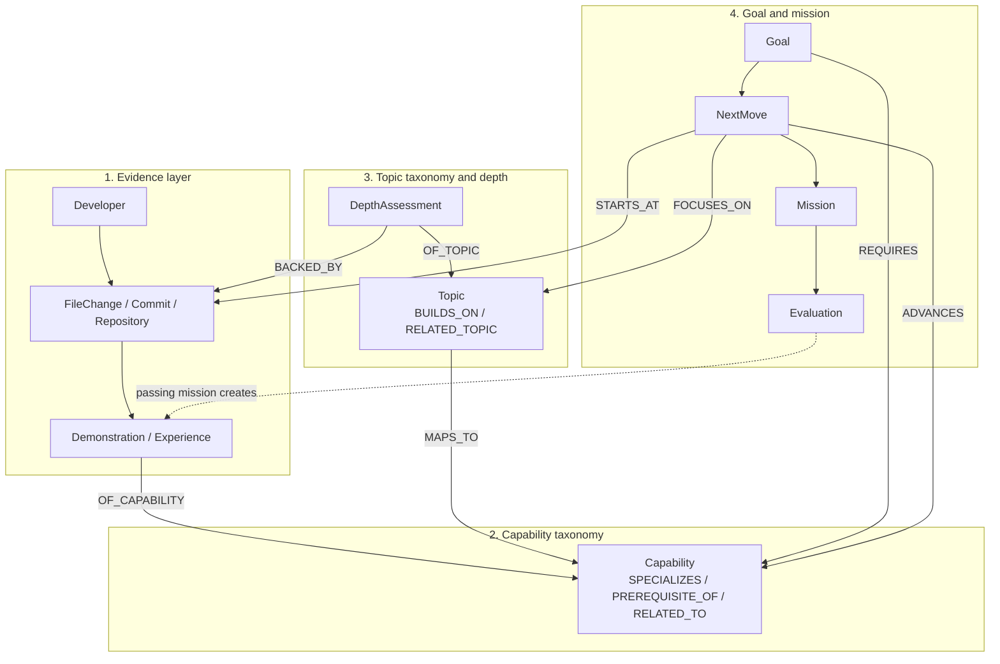
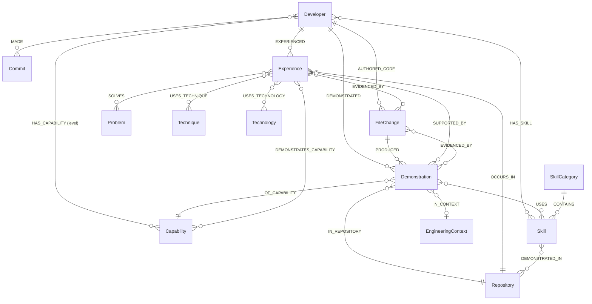
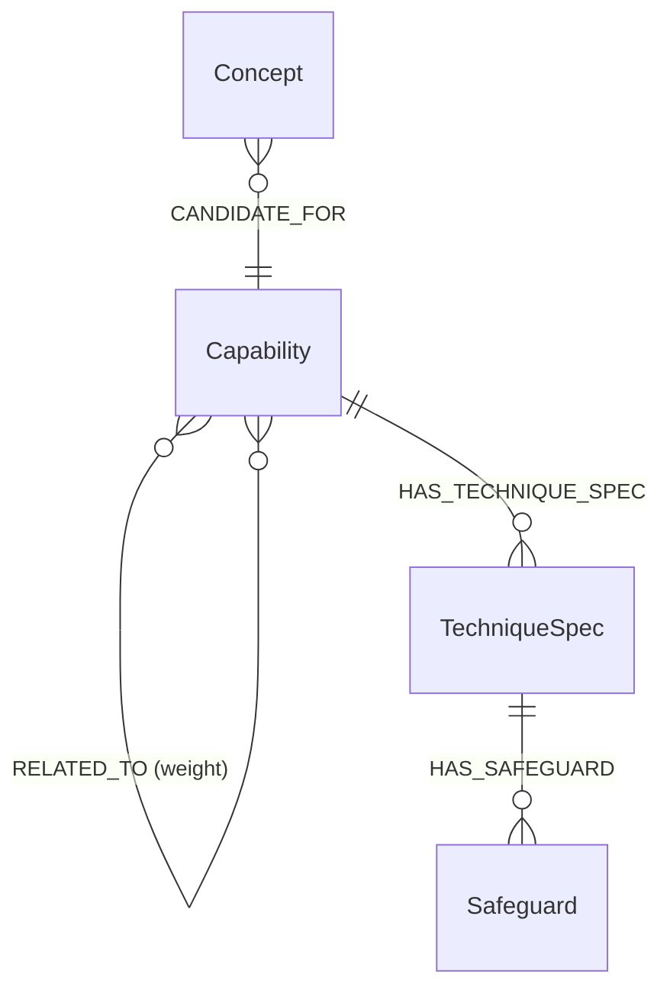
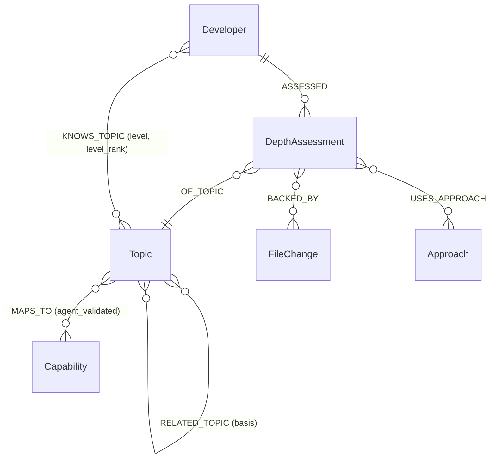
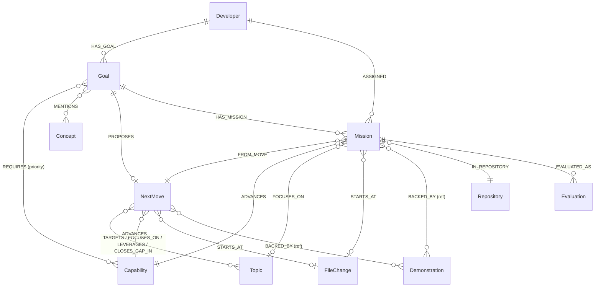
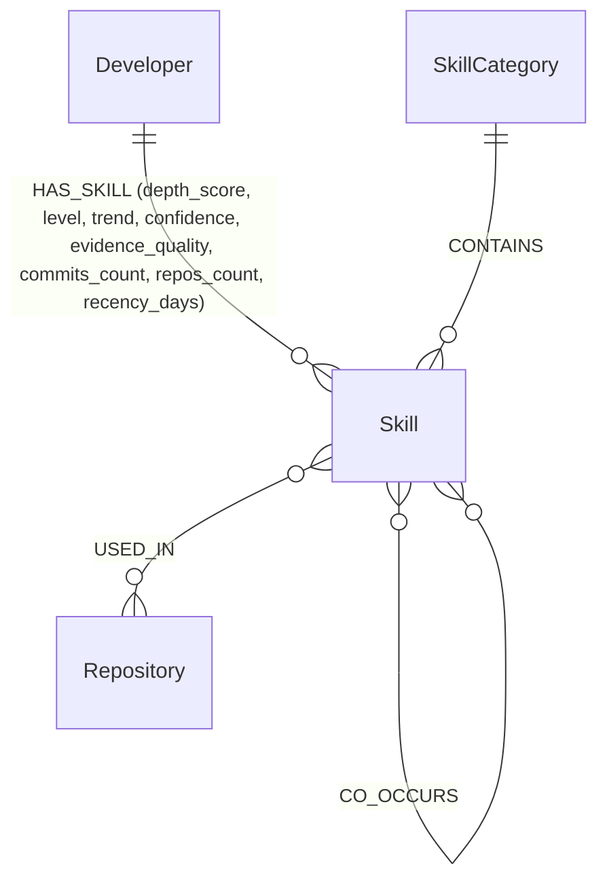
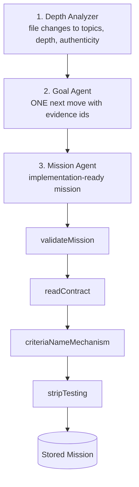
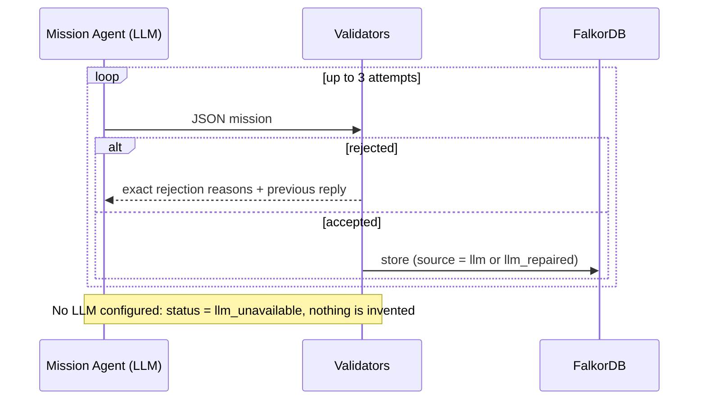

<div align="center">


### Your GitHub history, turned into a knowledge graph that assigns your next coding mission.

**Built for the FalkorDB Hackathon**


[🎬 Demo video](https://www.youtube.com/watch?v=Pc49zZzByUw) · [📝 Blog post](https://medium.com/@aymaanpathan5/pathway-we-turned-github-history-into-a-knowledge-graph-that-assigns-you-your-next-coding-mission-2c240a2bf45e) · [Report a bug](../../issues)

</div>

---

## 📖 What is Pathway?

Pathway is an AI-powered developer growth platform. It reads your GitHub coding history, builds a **knowledge graph** of what you have actually built, connects that evidence to engineering capabilities, and recommends **one specific coding mission** in your own repository.

When you complete a mission and the platform's tests pass, the verified code becomes **new evidence** in the graph and shapes your next recommendation.

> Pathway understands what you've built, figures out what you can work on next, gives you a real coding task, and learns from your verified progress.

| Typical growth tools | Pathway |
|---|---|
| Self-rated skills or quiz scores | Skills derived from **real file changes** |
| "Top 10 tutorials" lists | **One mission** anchored to a file in *your* repo |
| Checkbox completion | Completion must **pass platform-run tests** |
| Opaque scoring | **Graph algorithms**: PageRank, betweenness, label propagation, WCC |

---

## 🎬 Demo and write-up

- **Demo video:** [https://www.youtube.com/watch?v=Pc49zZzByUw](https://www.youtube.com/watch?v=Pc49zZzByUw)
- **Blog post:** [How Pathway turns GitHub history into a knowledge graph](https://medium.com/@aymaanpathan5/pathway-we-turned-github-history-into-a-knowledge-graph-that-assigns-you-your-next-coding-mission-2c240a2bf45e)

---

## 📑 Table of contents

1. [Architecture](#-architecture)
2. [3D Skill City](#%EF%B8%8F-3d-skill-city)
3. [Graph data model](#%EF%B8%8F-graph-data-model)
4. [Graph algorithms](#-graph-algorithms)
5. [Agent pipeline](#-agent-pipeline)
6. [Chat agent tools](#-chat-agent-tools)
7. [Setup instructions](#-setup-instructions)
8. [Explore the graph](#-explore-the-graph-yourself)
9. [Troubleshooting](#%EF%B8%8F-troubleshooting)

---

## 🏗️ Architecture



> The two views are **independent consumers of the same evidence**. The 3D city reads only the Skill graph. The chat agent, goal agent and mission agent read only the Topic graph. Neither calls the other.

---

## 🏙️ 3D Skill City


An interactive 3D view of the developer's skills, built with **React Three Fiber**. It is driven entirely by the **Skill graph** and has no connection to the chat agent or the Topic graph.



| Visual | Graph data |
|---|---|
| **Hub** at the centre | The `Developer` |
| **Building** on a ring around the hub | A `SkillCategory` (ring radius grows with the number of categories) |
| **Floor** inside a building (top skills by score, capped) | A `Skill` via `(SkillCategory)-[:CONTAINS]->(Skill)` |
| Floor order (highest on top) | `HAS_SKILL.depth_score`, then depth rank |
| 5-dot depth meter | Skill level: `novice → familiar → proficient → advanced → expert` |
| Trend badge on the sign (▲ rising, ▼ cooling, zz dormant) | `HAS_SKILL.trend` |
| Bar chart on the monitor | Monthly activity (`activity[].count`, last 12 months) |
| Package flying along a bridge | A category arriving while the graph regenerates (streamed over SSE) |
| **Skill Insights panel** | Strongest, rising, cooling, thin evidence, and "learn next" (adjacent skills via `CO_OCCURS` / `implies`) |
| **Skill Evidence panel** | The commits and files that prove a skill (`/api/skills/:slug`) |

**Camera.** An overview shot of the whole city, and a "dollhouse" fly-to when a building is selected so every floor is visible. Orbit, pan and zoom via `OrbitControls`.

**Endpoints used by the city**

| Route | Purpose |
|---|---|
| `GET /api/graph/summary` | Categories, skills and insights for the city |
| `GET /api/graph/regenerate` | Rebuilds the skill graph, streaming progress over SSE (`area_ready` per building) |
| `GET /api/skills/:slug` | Skill detail with commit-level proof |
| `GET /api/skills/graph`, `/insights`, `/taxonomy` | Skill graph, insights, and the skill taxonomy |
| `GET /api/graph/debug-intelligence` | Counts of skills, capabilities, demonstrations, and relationships |

---

## 🕸️ Graph data model


The graph lives in **FalkorDB** and is queried with **Cypher**. Every write is an idempotent `MERGE` keyed on `id`, so re-running any stage is safe. It has four connected layers for the agents, plus an independent Skill graph for the 3D city:



### Layer 1: Evidence (what the developer actually did)



| Node | Key properties |
|---|---|
| `Developer` | `id`, `topic_depth_summary_json` (headline and pattern from the last analysis) |
| `Commit`, `FileChange` | `id`, authored timestamps, `added_code`, language |
| `Repository` | `id`, name |
| `Demonstration` | `id`, `technique`, `summary`, `depth`, `depth_rank`, `path`, `commit_sha`, `permalink`, `source` (`"mission"` for mission-verified evidence), `mission_id` |
| `Experience` | `id`, `fingerprint` (dedupe key) |

> **Verified vs. inferred.** Only edges produced from the developer's own code (`HAS_CAPABILITY`, `DEMONSTRATED`) count as evidence. Structural edges are `basis = "declared"`; anything guessed from goal text or similarity is `basis = "inferred"` and can never satisfy a prerequisite.

### Layer 2: Capability taxonomy (what can be demonstrated)



| Kind | Rule |
|---|---|
| **Learnable capability** (`parentId != null`) | Specific, evidence-checkable (e.g. `distributed_locking`, `job_queues`, `idempotent_operations`). Can be demonstrated, required by a goal, and recommended. |
| **Domain** (`parentId = null`) | Groups learnable capabilities via `SPECIALIZES` (e.g. `concurrency_control`, `async_processing`). Never a prerequisite. |
| **Concept** | Created from goal text, `basis = "inferred"`. Never demonstrated, never gates a prerequisite. |

### Layer 3: Topic taxonomy and depth assessment



`Topic` properties: `id`, `slug`, `name`, `domain` (`frontend | backend | database | infrastructure | ai_ml | mobile | general`), `description`, `aliases_text`, plus **algorithm results written back onto the node**:

| Property | Written by |
|---|---|
| `foundation_rank` | `algo.pageRank` |
| `bridge_score` | `algo.betweenness` |
| `cluster_id` | `algo.labelPropagation` |
| `component_id` | `algo.WCC` |

**Edge semantics.** `(advanced)-[:BUILDS_ON]->(prerequisite)`: the target should be understood *before* the source. `strength` is `required` (cannot be learned without it) or `helpful`. `basis` is `llm_inferred`, `evidence_overlap`, or `curated`, so no edge is anonymous.

**`DepthAssessment`** (one per developer and topic) carries `level`, `level_rank`, `score`, `confidence`, `authenticity`, `verdict`, `rationale`, `strengths_json`, `gaps_json`, `evidence_refs_json`, `files`, `commits`, `repos`, `active_days`, `first_seen`, `last_seen`.

| Depth level | Rank | Score band |
|---|---|---|
| `none` | 0 | 0 |
| `surface` | 1 | 1 – 19 |
| `working` | 2 | 20 – 39 |
| `proficient` | 3 | 40 – 64 |
| `deep` | 4 | 65 – 100 |

**Authenticity** (was it built, or just present?): `genuine_implementation`, `working_usage`, `incidental`, `boilerplate`, `insufficient_evidence`.

### Layer 4: Goal, NextMove, Mission, Evaluation



| Node | Key properties |
|---|---|
| `Goal` | `id`, `developer_id`, `wish`, `resolved_by` |
| `NextMove` | `title`, `summary`, `done_when`, `details_json` (challenge, decision, steps) |
| `Mission` | `status` (`proposed → in_progress → submitted → …` or `abandoned`), `repository`, `branch`, `base_commit`, `start_path`, `capability_id`, `focus_slug`, `spec_json`, `pin_json`, `explanation_json` |
| `Evaluation` | `verdict`, `head_commit`, `ci_state`, `summary`, `results_json`, `scope_warnings_json`, `changed_files_json` |

**Design notes**

- A `Mission` stores a **full snapshot** of the move it came from, because planning a new move replaces the goal's `NextMove`.
- `explanation_json` stores a **trace of the real queries** that ran while loading the move (pattern, Cypher, params, row counts). Nothing is reconstructed afterwards.
- A passing evaluation writes a new `(Developer)-[:DEMONSTRATED]->(Demonstration {source:"mission"})-[:OF_CAPABILITY]->(Capability)`. This is the **closed loop**: verified work becomes graph evidence.

### Separate view: the Skill graph (powers the 3D city)

Independent of the Topic graph. It is built from the same file-change evidence using rule-based signals (a definitive path such as `Dockerfile`, or a real import or API call in the added code, counts as strong evidence; a language-only match counts as weak).



| Property on `HAS_SKILL` | Meaning |
|---|---|
| `depth_score` | 0 to 100 score, with an evidence-quality multiplier |
| `level` | `novice`, `familiar`, `proficient`, `advanced`, `expert` |
| `trend` | `rising`, `steady`, `cooling`, `dormant` |
| `confidence` | `low`, `medium`, `high` |
| `files_touched`, `strong_files`, `commits_count`, `repos_count`, `recency_days` | Evidence counts behind the score |

The taxonomy also declares `implies` (Next.js implies React) and `related` skills, which feed the "learn next" suggestions.

### Indexes

```cypher
CREATE INDEX FOR (n:Developer) ON (n.id)
CREATE INDEX FOR (n:Topic) ON (n.id)
CREATE INDEX FOR (n:Capability) ON (n.id)
CREATE INDEX FOR (n:DepthAssessment) ON (n.id)
CREATE INDEX FOR (n:DepthAssessment) ON (n.developer_id)
CREATE INDEX FOR (n:DepthAssessment) ON (n.topic_slug)
CREATE INDEX FOR (n:Demonstration) ON (n.id)
CREATE INDEX FOR (n:Experience) ON (n.fingerprint)
CREATE INDEX FOR (n:Goal) ON (n.id)
-- plus Commit, FileChange, Repository, Approach, Concept, Problem, Technique, Technology ...

CALL db.idx.fulltext.createNodeIndex('Topic', 'name', 'description', 'aliases_text')
```

---

## 🧮 Graph algorithms

Ordering and ranking come from **graph position**, not from an LLM-invented score.

| Question | FalkorDB feature | Stored as / tool |
|---|---|---|
| What are my foundations? | `algo.pageRank('Topic', 'BUILDS_ON')` (falls back to `RELATED_TOPIC` if no `BUILDS_ON` edges) | `foundation_rank` · `rank_foundations` |
| What connects my skills? | `algo.betweenness` | `bridge_score` · `find_bridges` |
| What do I work on together? | `algo.labelPropagation` over `RELATED_TOPIC` | `cluster_id` · `knowledge_communities` |
| Which areas are disconnected? | `algo.WCC` | `component_id` |
| How do topic X and Y connect? | `shortestPath((a)-[:BUILDS_ON\|RELATED_TOPIC*1..6]->(b))` | `connect_topics` |
| How do I get to X? | `BUILDS_ON*1..4` variable-length traversal | `learning_path_to_topic` |
| What is ready for me? | `BUILDS_ON` traversal + `KNOWS_TOPIC` join | `recommend_next_topics` |
| What capability is still missing for my goal? | `[:SPECIALIZES\|PREREQUISITE_OF\|RELATED_TO*1..4]` from goal-required capabilities | Goal frontier |

Metrics are refreshed safely: each metric is computed, written, and **only then** are stale values of that metric removed, so a failed run leaves the previous ranks intact.

<details>
<summary><b>Prerequisite roadmap query</b></summary>

```cypher
MATCH path = (t:Topic {slug: $slug})-[:BUILDS_ON*1..4]->(f:Topic)
WITH f, min(length(path)) AS hops
OPTIONAL MATCH (:Developer {id: $dev})-[k:KNOWS_TOPIC]->(f)
RETURN f.slug AS slug, f.name AS name, hops,
       coalesce(k.level, "") AS level,
       coalesce(k.level_rank, -1) AS rank
```
</details>

<details>
<summary><b>Community detection</b></summary>

```cypher
CALL algo.labelPropagation({
  nodeLabels: ['Topic'],
  relationshipTypes: ['RELATED_TOPIC'],
  maxIterations: 10
})
YIELD node, communityId
RETURN node.slug AS slug, communityId
```
</details>

---

## 🤖 Agent pipeline



### Mission Agent guarantees


- **At most 5 files**, all implementation; `modifyPaths` includes the start file
- **Exactly 3 acceptance criteria**, each an observable test case the platform runs
- **3 to 5 steps**: step 1 opens the start file, the last commits and pushes
- **`grounding.observedNow`**: a verbatim 12-140 char fragment of the real code
- **`contract`**: library, exported names, key format, TTL, lifecycle, error behavior
- **Criteria prove the mechanism**: at least 2 name the required library and assert the interaction, so a trivial local `Map` cannot pass

The developer **never writes tests**. The platform generates them from the criteria and runs them in a sandbox, so verification is independent of the person being verified.

### Self-repairing generation loop



### Grounding: the gap probe

Before the agent may claim "your code lacks X", Pathway checks `package.json` dependencies, the start file text, and file paths. If anything matches, the agent must describe what the code actually shows instead of claiming a gap.

---

## 🧰 Chat agent tools


16 typed tools, each declaring `name`, `description`, `whenToUse`, the FalkorDB `features` it uses, and a parameter schema. That one declaration feeds the **planner**, the **argument validator** (`parseToolArgs` clamps numbers, enforces enums, drops unknown keys), and the **UI**.

| Tool | Graph capability |
|---|---|
| `profile_overview` | DepthAssessment roll-up, PageRank/betweenness ordering |
| `strongest_topics` | Depth levels and graph position |
| `find_gaps` | Gaps relative to graph structure |
| `recommend_next_topics` | `BUILDS_ON` traversal + `KNOWS_TOPIC` join |
| `learning_path_to_topic` | `BUILDS_ON*1..4` traversal |
| `rank_foundations` | `algo.pageRank` |
| `find_bridges` | `algo.betweenness` |
| `knowledge_communities` | `algo.labelPropagation` |
| `connect_topics` | `shortestPath` between topics |
| `explore_neighborhood` | Neighborhood queries |
| `connectivity_check` | Structural connectivity |
| `explain_topic` | Topic detail and context |
| `compare_topics` | Side-by-side structural comparison |
| `search_topics` | Full-text index on `Topic` |
| `audit_authenticity` | Genuine vs. superficial usage |
| `recent_activity` | `last_seen` reads: active vs. gone quiet |

> The chat agent reads the **Topic graph** only.

Every call runs through `runTool` with a **20 s timeout** and returns a `ToolRun` with the result, latency, and a plain-language `how[]` trail. Tools return structured UI blocks (`roadmap`, `ranking`, `groups`, `timeline`, `stats`, `callout`): the LLM narrates, the graph supplies the facts.

---

## 🧱 Tech stack

| Layer | Technology |
|---|---|
| Graph database | **FalkorDB** (Docker), Cypher, built-in graph algorithms |
| Backend | Node.js, TypeScript (ESM) |
| AI | LLM agents with validator and repair loops |
| Frontend | **React**, **React Three Fiber** + drei (3D Skill City) |
| API | Express (REST + SSE) |
| Verification | Sandboxed, platform-generated tests |
| Infra | Docker |

---

## 🚀 Setup instructions

### Prerequisites

- **Node.js** 20+ and **npm** (or pnpm / yarn)
- **Docker** (for FalkorDB)
- A **GitHub token** (to read commit history)
- An **LLM API key** (the Mission Agent will not run without one)

### 1. Clone

```bash
git clone https://github.com/<your-username>/pathway.git
cd pathway
```

### 2. Start FalkorDB with Docker

```bash
docker run -d --name falkordb \
  -p 6379:6379 \
  -p 3000:3000 \
  -v falkordb_data:/var/lib/falkordb/data \
  falkordb/falkordb:latest
```

| Port | Purpose |
|---|---|
| `6379` | FalkorDB (Redis protocol), used by the backend |
| `3000` | FalkorDB Browser UI at http://localhost:3000 |

> If port `3000` clashes with another service, map the browser elsewhere, e.g. `-p 3001:3000`.

Verify:

```bash
docker exec -it falkordb redis-cli PING
# PONG
```

**Or with Docker Compose:**

```yaml
# docker-compose.yml
services:
  falkordb:
    image: falkordb/falkordb:latest
    container_name: falkordb
    ports:
      - "6379:6379"
      - "3001:3000"
    volumes:
      - falkordb_data:/var/lib/falkordb/data
    restart: unless-stopped

volumes:
  falkordb_data:
```

```bash
docker compose up -d
```

### 3. Configure the backend

```bash
cd backend
cp .env.example .env
```

```env
# FalkorDB
FALKORDB_HOST=localhost
FALKORDB_PORT=6379
FALKORDB_GRAPH=pathway

# GitHub
GITHUB_TOKEN=ghp_xxx

# LLM
LLM_API_KEY=sk-xxx
LLM_TIMEOUT_MS=30000

# Optional: log every successful mission query (failures always log)
MISSION_DEBUG=0

# Server
PORT=4000
```

> Variable names are placeholders: match them to your `.env.example`. `LLM_TIMEOUT_MS` and `MISSION_DEBUG` are read by the Mission Agent and graph layer.

### 4. Install and run the backend

```bash
npm install
npm run dev
```

Backend: **http://localhost:4000**. On first run it creates the indexes and the full-text index on `Topic`, and seeds the capability taxonomy.

### 5. Run the frontend

```bash
cd ../frontend
npm install
npm run dev
```

Frontend: **http://localhost:5173**. The 3D Skill City uses `three`, `@react-three/fiber`, and `@react-three/drei`:

```bash
npm install three @react-three/fiber @react-three/drei
```

### 6. Try the full loop

1. Sign in with GitHub and sync your repositories
2. Run the **analysis** (Depth Analyzer builds `DepthAssessment`s and `KNOWS_TOPIC` edges, then refreshes PageRank, betweenness, communities and WCC)
3. Set a **goal** on the Goal page
4. Get your **next move**, then your **mission**
5. Implement it, push your branch, and let the sandbox verify it
6. Watch the graph grow and the celebration screen appear


---

## 🔍 Explore the graph yourself

Open the FalkorDB Browser (http://localhost:3000, or your mapped port) and run:

```cypher
// A developer's assessed topics and depth
MATCH (d:Developer)-[:ASSESSED]->(a:DepthAssessment)-[:OF_TOPIC]->(t:Topic)
RETURN d, a, t LIMIT 50

// Prerequisite structure
MATCH (a:Topic)-[b:BUILDS_ON]->(f:Topic)
RETURN a, b, f LIMIT 100

// Foundations by stored PageRank
MATCH (t:Topic) WHERE t.foundation_rank IS NOT NULL
RETURN t.name, t.foundation_rank ORDER BY t.foundation_rank DESC LIMIT 10

// Goal to mission chain
MATCH (g:Goal)-[:PROPOSES]->(n:NextMove)
OPTIONAL MATCH (g)-[:HAS_MISSION]->(m:Mission)-[:EVALUATED_AS]->(e:Evaluation)
RETURN g, n, m, e

// Evidence behind a mission-verified capability
MATCH (d:Developer)-[:DEMONSTRATED]->(x:Demonstration {source: "mission"})-[:OF_CAPABILITY]->(c:Capability)
RETURN d, x, c
```

---

## 🛠️ Troubleshooting

| Problem | Fix |
|---|---|
| `ECONNREFUSED 6379` | FalkorDB is not running: `docker ps`, then `docker start falkordb` |
| Empty foundation ranking | No `BUILDS_ON` edges yet: re-run the analysis so metrics refresh |
| Communities show only "Standalone" | Not enough `RELATED_TOPIC` links; the tool falls back to `Topic.cluster_id` |
| `llm_unavailable` on mission | Set `LLM_API_KEY`; Pathway will not invent a mission without an LLM |
| `generation_failed` | All 3 repair attempts were rejected: read the rejection notes in the logs |
| "N of M rows matched nothing" in logs | A `MATCH` in a batch write found no node; check that parent nodes were written first |
| Port 3000 already in use | Remap the FalkorDB Browser with `-p 3001:3000` |
| Tool timed out | Tools are capped at 20 s: check graph size and DB health |

---

## 🗺️ Roadmap

- [ ] Team graphs: "who on my team could pair with me on this?" as one query
- [ ] Mission difficulty calibrated from `hops` and readiness
- [ ] Decay-aware recommendations from `last_seen` (refresher missions)
- [ ] More languages and taxonomy coverage

---

## 💡 Design principles

1. **Graph for structure, LLM for judgment**: ordering and readiness come from algorithms
2. **Ground every claim**: verbatim code, gap probes, evidence ids, stored query traces
3. **Independent verification**: platform tests run against developer code
4. **Evidence over assertion**: only verified edges count; inferred edges are labeled
5. **Self-describing tools**: adding a graph tool is a single file

---

<div align="center">

### ⭐ If you like Pathway, please star the repo!

</div>
