<div align="center">


### Your GitHub history, turned into a knowledge graph that assigns your next coding mission.

**Built for the FalkorDB Hackathon**


[🎬 Demo video](https://www.youtube.com/watch?v=Pc49zZzByUw) · [📝 Blog post](https://medium.com/@aymaanpathan5/pathway-we-turned-github-history-into-a-knowledge-graph-that-assigns-you-your-next-coding-mission-2c240a2bf45e) · [Report a bug](../../issues)

</div>

---

## 📖 What is Pathway?

Pathway is an AI-powered developer growth platform. It reads your GitHub coding history, builds a **knowledge graph** of what you have actually built, connects that evidence to engineering capabilities, and recommends **one specific coding mission** in your own repository.

When you complete a mission and the platform's tests pass, the verified code becomes **new evidence** in the graph and shapes your next recommendation.

> Pathway understands what you've built, figures out what you can work on next, gives you a real coding task, and learns from your verified progress.

| Typical growth tools | Pathway |
|---|---|
| Self-rated skills or quiz scores | Skills derived from **real file changes** |
| "Top 10 tutorials" lists | **One mission** anchored to a file in *your* repo |
| Checkbox completion | Completion must **pass platform-run tests** |
| Opaque scoring | **Graph algorithms**: PageRank, betweenness, label propagation, WCC |

---

## 🎬 Demo and write-up

- **Demo video:** [https://www.youtube.com/watch?v=Pc49zZzByUw](https://www.youtube.com/watch?v=Pc49zZzByUw)
- **Blog post:** [How Pathway turns GitHub history into a knowledge graph](https://medium.com/@aymaanpathan5/pathway-we-turned-github-history-into-a-knowledge-graph-that-assigns-you-your-next-coding-mission-2c240a2bf45e)

---

## 📑 Table of contents

1. [Architecture](#-architecture)
2. [GitHub MCP server](#-github-mcp-server)
3. [GitHub sync pipeline](#-github-sync-pipeline)
4. [3D Skill City](#%EF%B8%8F-3d-skill-city)
5. [Graph data model](#%EF%B8%8F-graph-data-model)
6. [Graph algorithms](#-graph-algorithms)
7. [Agent pipeline](#-agent-pipeline)
8. [Chat agent tools](#-chat-agent-tools)
9. [Setup instructions](#-setup-instructions)
10. [Troubleshooting](#%EF%B8%8F-troubleshooting)

---

## 🏗️ Architecture

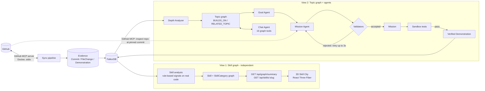

> The two views are **independent consumers of the same evidence**. The 3D city reads only the Skill graph. The chat agent, goal agent and mission agent read only the Topic graph. Neither calls the other.

---

## 🔌 GitHub MCP server

Pathway reaches GitHub **only through the official [GitHub MCP server](https://github.com/github/github-mcp-server)** (Model Context Protocol). There is no hand-written GitHub REST client: the backend starts the server as a short-lived Docker container and talks to it over stdio with the MCP client SDK.

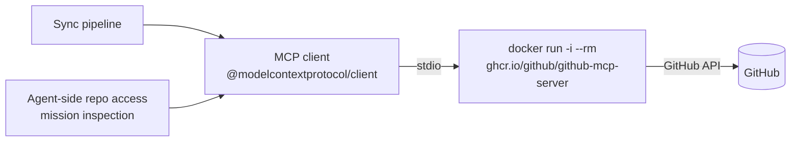

**Read-only tool allow-list.** The container is started with `GITHUB_TOOLS`, so only these tools exist for the session:

| MCP tool | Used for |
|---|---|
| `get_me` | Resolve the signed-in developer |
| `search_repositories` | Discover the developer's repositories |
| `list_commits` | Find the developer's commits (initial window or incremental) |
| `get_commit` | Fetch the full patch and per-file diffs of a commit |
| `get_file_contents` | README, manifests and config files; repo inspection at a commit |
| `list_pull_requests` | Pull requests per repository |
| `pull_request_read` | Optional PR detail and changed files |
| `search_issues` | Issues the developer opened and pull requests they reviewed |

**Design notes**

- **One file per tool.** `get-commit.ts`, `list-commits.ts`, and so on are thin wrappers around a single `GithubMcpCall` function, so sync code and agents share them.
- **Token never goes on the command line.** Docker is passed `-e GITHUB_PERSONAL_ACCESS_TOKEN` and the value comes from the process environment.
- **Two entry points.** `syncDeveloperGithubData` opens one session for a whole sync. `withGithubMcp(token, tools, fn)` opens a scoped session with its own tool list and closes it afterwards, for agent-side repository access. The scoped helper pins the server image (`v1.11.0`).
- **SHA-aware file reads.** `get_file_contents` only resolves branch and tag names as `ref`, so a 40-hex commit id is moved to the `sha` argument automatically.
- **Raw vs. parsed results.** `clientCall` returns the raw MCP result for the sync parser. `withGithubMcp` returns `{ ok, data, text }`.

---

## 🔄 GitHub sync pipeline

Sync turns a developer's GitHub activity into graph evidence. It is incremental, rate-limit aware, and idempotent (every write is a `MERGE`).

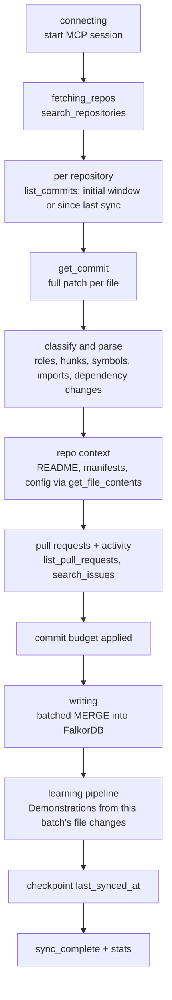

Progress events (`connecting`, `repos_found`, `repo_started`, `commits_discovered`, `sync_progress`, `writing`, `learning_complete`, `sync_complete`, and others) are streamed to the UI.

**What gets extracted from every commit**

| Evidence | Examples |
|---|---|
| File role | `source`, `test`, `migration`, `schema`, `style`, `markup`, `config`, `infra`, `dependency_manifest` |
| Diff structure | Hunks, touched scopes, additions and deletions, renames |
| Code signals | Symbols added, modified and removed; imports added and removed; relative imports; comment lines; max indent depth |
| Dependencies | Added, removed and changed packages parsed from `package.json`, `pyproject.toml`, `requirements.txt`, `go.mod`, `Cargo.toml`, `Gemfile`, `composer.json` |
| Repo context | README, manifest and config files, root entries, tooling, dependency map (refreshed every 7 days by default) |

Lockfiles, `node_modules/`, `dist/`, generated and minified files, images and docs are filtered out, so only authored source evidence reaches the graph. Stored patches are capped (60k chars of diff and 40k of added code per file by default) to keep MCP traffic and graph size small.

**What sync writes to FalkorDB**

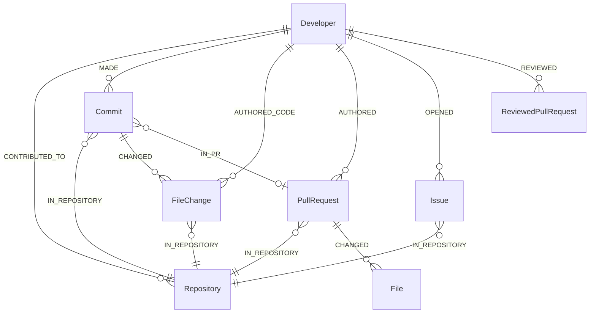

**Built for real accounts**

- **Incremental.** A per-repository `last_synced_at` checkpoint plus a 7-day overlap window, so reruns only fetch what is new.
- **Budgeted onboarding.** First sync is capped (60 commits per repository, 400 total, last 365 days by default), newest first.
- **Rate-limit aware.** Each call retries up to 3 times with exponential backoff and jitter. On a GitHub rate limit the sync stops retrying, skips the remaining calls, and reports `rateLimited` instead of hanging. Repositories that failed discovery are not checkpointed, so the next run picks them up.
- **Resilient enrichment.** The learning stage is separate: if the LLM provider is down, the GitHub data is still saved and a `learning_failed` event is emitted.
- **Bounded concurrency.** Repositories, commits and PR details are fetched with configurable concurrency.
- **Clean graph.** Evidence outside the history window, excluded repositories (`GITHUB_EXCLUDE_REPOS`) and inactive repository links are pruned.
- **Safe Cypher.** Labels and properties interpolated into index queries pass an identifier allow-list.
- **Run stats.** Each sync returns repositories, commits discovered and processed, files changed, source and test files, patches stored, hunks, symbols, imports, dependency changes, GitHub retries, and final graph node and relationship counts.

**Built-in graph analytics** (run over the synced evidence)

```cypher
// Files that are frequently changed together (co-change coupling)
MATCH (d:Developer {id: $developer_id})-[:AUTHORED_CODE]->(fc1:FileChange)
      <-[:CHANGED]-(c:Commit)-[:CHANGED]->(fc2:FileChange)
WHERE fc1.path < fc2.path
WITH fc1.path AS pathA, fc2.path AS pathB, count(DISTINCT c) AS co_changes
WHERE co_changes >= 5
RETURN pathA, pathB, co_changes ORDER BY co_changes DESC LIMIT 50
```

```cypher
// File hotspots
MATCH (d:Developer {id: $developer_id})-[:AUTHORED_CODE]->(fc:FileChange)
RETURN fc.path AS path, fc.language AS language,
       count(DISTINCT fc.commit_sha) AS commits,
       sum(fc.additions) AS additions, sum(fc.deletions) AS deletions
ORDER BY commits DESC LIMIT 50
```

---

## 🏙️ 3D Skill City


An interactive 3D view of the developer's skills, built with **React Three Fiber**. It is driven entirely by the **Skill graph** and has no connection to the chat agent or the Topic graph.

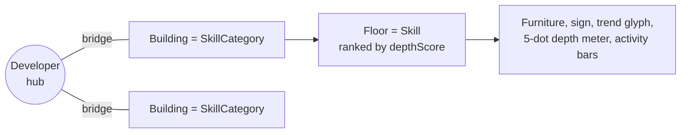

| Visual | Graph data |
|---|---|
| **Hub** at the centre | The `Developer` |
| **Building** on a ring around the hub | A `SkillCategory` (ring radius grows with the number of categories) |
| **Floor** inside a building (top skills by score, capped) | A `Skill` via `(SkillCategory)-[:CONTAINS]->(Skill)` |
| Floor order (highest on top) | `HAS_SKILL.depth_score`, then depth rank |
| 5-dot depth meter | Skill level: `novice → familiar → proficient → advanced → expert` |
| Trend badge on the sign (▲ rising, ▼ cooling, zz dormant) | `HAS_SKILL.trend` |
| Bar chart on the monitor | Monthly activity (`activity[].count`, last 12 months) |
| Package flying along a bridge | A category arriving while the graph regenerates (streamed over SSE) |
| **Skill Insights panel** | Strongest, rising, cooling, thin evidence, and "learn next" (adjacent skills via `CO_OCCURS` / `implies`) |
| **Skill Evidence panel** | The commits and files that prove a skill (`/api/skills/:slug`) |

**Camera.** An overview shot of the whole city, and a "dollhouse" fly-to when a building is selected so every floor is visible. Orbit, pan and zoom via `OrbitControls`.

**Endpoints used by the city**

| Route | Purpose |
|---|---|
| `GET /api/graph/summary` | Categories, skills and insights for the city |
| `GET /api/graph/regenerate` | Rebuilds the skill graph, streaming progress over SSE (`area_ready` per building) |
| `GET /api/skills/:slug` | Skill detail with commit-level proof |
| `GET /api/skills/graph`, `/insights`, `/taxonomy` | Skill graph, insights, and the skill taxonomy |
| `GET /api/graph/debug-intelligence` | Counts of skills, capabilities, demonstrations, and relationships |

---

## 🕸️ Graph data model


The graph lives in **FalkorDB** and is queried with **Cypher**. Every write is an idempotent `MERGE` keyed on `id`, so re-running any stage is safe. It has four connected layers for the agents, plus an independent Skill graph for the 3D city:

<p align="center">
  
  <br/>
  <sub><b>The real graph in FalkorDB Browser:</b> one developer's demonstrations, the capabilities they prove, and the file changes behind them.</sub>
</p>

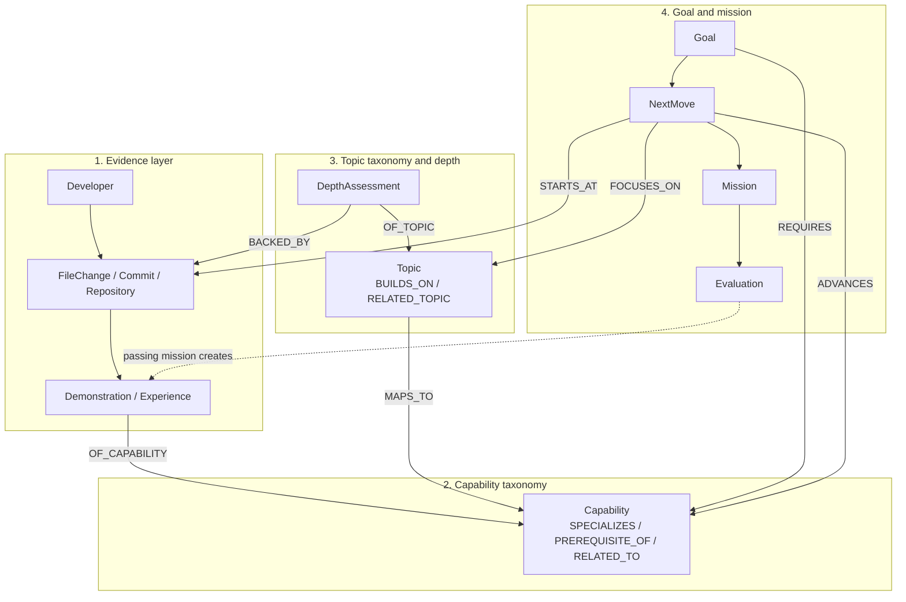

### Layer 1: Evidence (what the developer actually did)

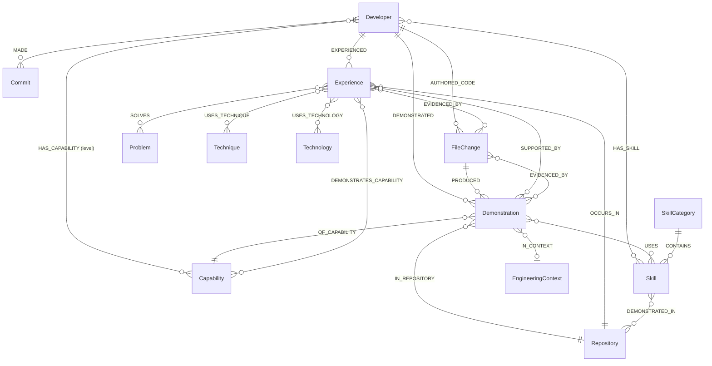

| Node | Key properties |
|---|---|
| `Developer` | `id`, `topic_depth_summary_json` (headline and pattern from the last analysis) |
| `Commit`, `FileChange` | `id`, authored timestamps, `added_code`, language |
| `Repository` | `id`, name |
| `Demonstration` | `id`, `technique`, `summary`, `depth`, `depth_rank`, `path`, `commit_sha`, `permalink`, `source` (`"mission"` for mission-verified evidence), `mission_id` |
| `Experience` | `id`, `fingerprint` (dedupe key) |

> **Verified vs. inferred.** Only edges produced from the developer's own code (`HAS_CAPABILITY`, `DEMONSTRATED`) count as evidence. Structural edges are `basis = "declared"`; anything guessed from goal text or similarity is `basis = "inferred"` and can never satisfy a prerequisite.

### Layer 2: Capability taxonomy (what can be demonstrated)

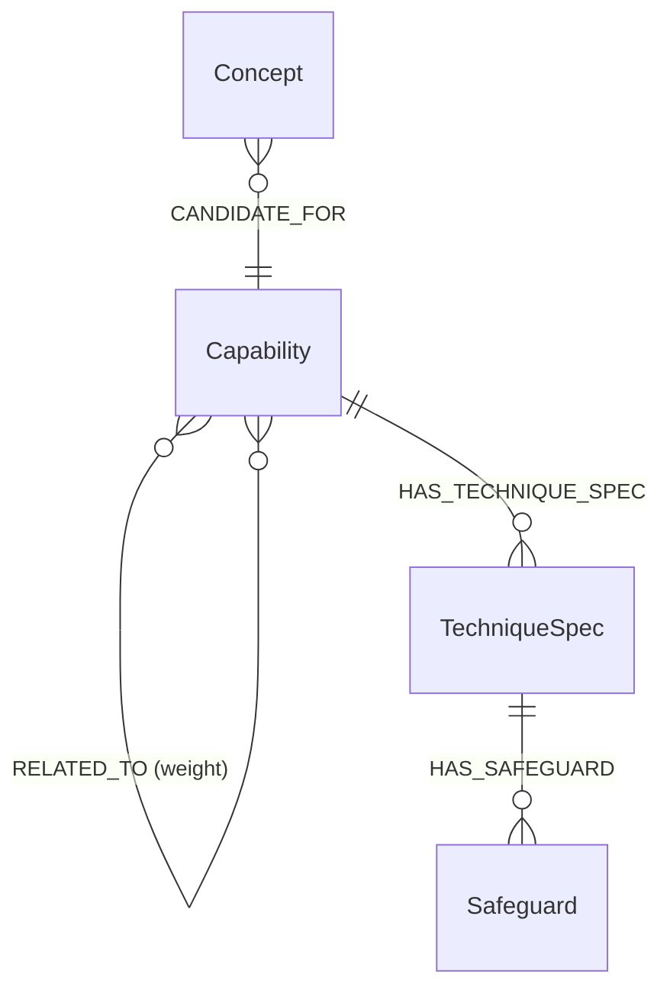

| Kind | Rule |
|---|---|
| **Learnable capability** (`parentId != null`) | Specific, evidence-checkable (e.g. `distributed_locking`, `job_queues`, `idempotent_operations`). Can be demonstrated, required by a goal, and recommended. |
| **Domain** (`parentId = null`) | Groups learnable capabilities via `SPECIALIZES` (e.g. `concurrency_control`, `async_processing`). Never a prerequisite. |
| **Concept** | Created from goal text, `basis = "inferred"`. Never demonstrated, never gates a prerequisite. |

### Layer 3: Topic taxonomy and depth assessment

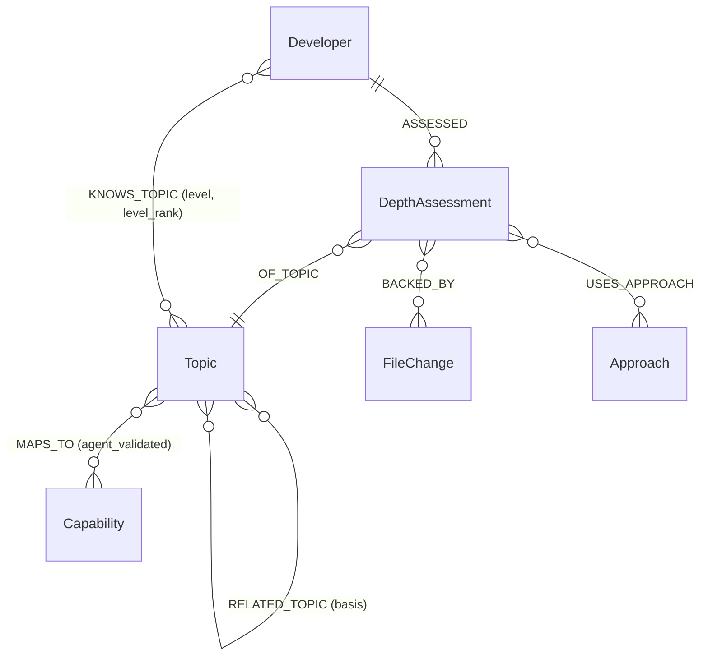

`Topic` properties: `id`, `slug`, `name`, `domain` (`frontend | backend | database | infrastructure | ai_ml | mobile | general`), `description`, `aliases_text`, plus **algorithm results written back onto the node**:

| Property | Written by |
|---|---|
| `foundation_rank` | `algo.pageRank` |
| `bridge_score` | `algo.betweenness` |
| `cluster_id` | `algo.labelPropagation` |
| `component_id` | `algo.WCC` |

**Edge semantics.** `(advanced)-[:BUILDS_ON]->(prerequisite)`: the target should be understood *before* the source. `strength` is `required` (cannot be learned without it) or `helpful`. `basis` is `llm_inferred`, `evidence_overlap`, or `curated`, so no edge is anonymous.

**`DepthAssessment`** (one per developer and topic) carries `level`, `level_rank`, `score`, `confidence`, `authenticity`, `verdict`, `rationale`, `strengths_json`, `gaps_json`, `evidence_refs_json`, `files`, `commits`, `repos`, `active_days`, `first_seen`, `last_seen`.

| Depth level | Rank | Score band |
|---|---|---|
| `none` | 0 | 0 |
| `surface` | 1 | 1 – 19 |
| `working` | 2 | 20 – 39 |
| `proficient` | 3 | 40 – 64 |
| `deep` | 4 | 65 – 100 |

**Authenticity** (was it built, or just present?): `genuine_implementation`, `working_usage`, `incidental`, `boilerplate`, `insufficient_evidence`.

### Layer 4: Goal, NextMove, Mission, Evaluation

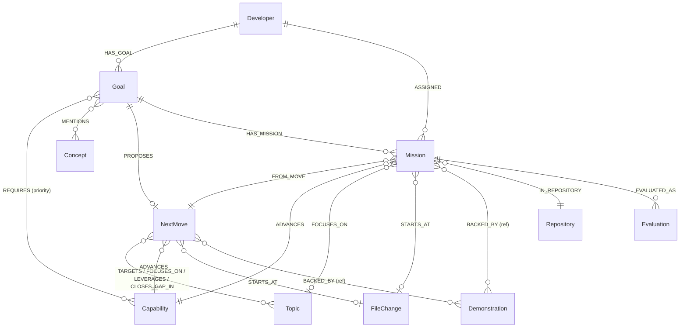

| Node | Key properties |
|---|---|
| `Goal` | `id`, `developer_id`, `wish`, `resolved_by` |
| `NextMove` | `title`, `summary`, `done_when`, `details_json` (challenge, decision, steps) |
| `Mission` | `status` (`proposed → in_progress → submitted → …` or `abandoned`), `repository`, `branch`, `base_commit`, `start_path`, `capability_id`, `focus_slug`, `spec_json`, `pin_json`, `explanation_json` |
| `Evaluation` | `verdict`, `head_commit`, `ci_state`, `summary`, `results_json`, `scope_warnings_json`, `changed_files_json` |

**Design notes**

- A `Mission` stores a **full snapshot** of the move it came from, because planning a new move replaces the goal's `NextMove`.
- `explanation_json` stores a **trace of the real queries** that ran while loading the move (pattern, Cypher, params, row counts). Nothing is reconstructed afterwards.
- A passing evaluation writes a new `(Developer)-[:DEMONSTRATED]->(Demonstration {source:"mission"})-[:OF_CAPABILITY]->(Capability)`. This is the **closed loop**: verified work becomes graph evidence.

### Separate view: the Skill graph (powers the 3D city)

Independent of the Topic graph. It is built from the same file-change evidence using rule-based signals (a definitive path such as `Dockerfile`, or a real import or API call in the added code, counts as strong evidence; a language-only match counts as weak).

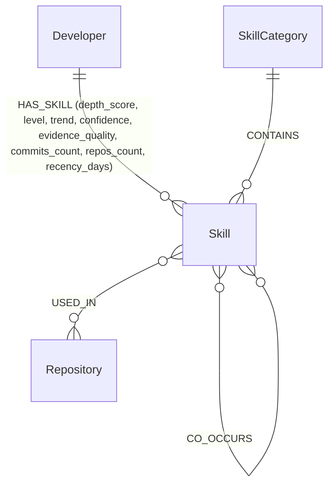

| Property on `HAS_SKILL` | Meaning |
|---|---|
| `depth_score` | 0 to 100 score, with an evidence-quality multiplier |
| `level` | `novice`, `familiar`, `proficient`, `advanced`, `expert` |
| `trend` | `rising`, `steady`, `cooling`, `dormant` |
| `confidence` | `low`, `medium`, `high` |
| `files_touched`, `strong_files`, `commits_count`, `repos_count`, `recency_days` | Evidence counts behind the score |

The taxonomy also declares `implies` (Next.js implies React) and `related` skills, which feed the "learn next" suggestions.

### Indexes

```cypher
CREATE INDEX FOR (n:Developer) ON (n.id)
CREATE INDEX FOR (n:Topic) ON (n.id)
CREATE INDEX FOR (n:Capability) ON (n.id)
CREATE INDEX FOR (n:DepthAssessment) ON (n.id)
CREATE INDEX FOR (n:DepthAssessment) ON (n.developer_id)
CREATE INDEX FOR (n:DepthAssessment) ON (n.topic_slug)
CREATE INDEX FOR (n:Demonstration) ON (n.id)
CREATE INDEX FOR (n:Experience) ON (n.fingerprint)
CREATE INDEX FOR (n:Goal) ON (n.id)
-- plus Commit, FileChange, Repository, Approach, Concept, Problem, Technique, Technology ...

CALL db.idx.fulltext.createNodeIndex('Topic', 'name', 'description', 'aliases_text')

-- created by sync ingestion
CALL db.idx.fulltext.createNodeIndex('Commit', 'message')
CALL db.idx.fulltext.createNodeIndex('FileChange', 'path', 'added_code')
CALL db.idx.fulltext.createNodeIndex('PullRequest', 'title', 'body')
CALL db.idx.fulltext.createNodeIndex('Issue', 'title', 'body')
```

---

## 🧮 Graph algorithms

Ordering and ranking come from **graph position**, not from an LLM-invented score.

| Question | FalkorDB feature | Stored as / tool |
|---|---|---|
| What are my foundations? | `algo.pageRank('Topic', 'BUILDS_ON')` (falls back to `RELATED_TOPIC` if no `BUILDS_ON` edges) | `foundation_rank` · `rank_foundations` |
| What connects my skills? | `algo.betweenness` | `bridge_score` · `find_bridges` |
| What do I work on together? | `algo.labelPropagation` over `RELATED_TOPIC` | `cluster_id` · `knowledge_communities` |
| Which areas are disconnected? | `algo.WCC` | `component_id` |
| How do topic X and Y connect? | `shortestPath((a)-[:BUILDS_ON\|RELATED_TOPIC*1..6]->(b))` | `connect_topics` |
| How do I get to X? | `BUILDS_ON*1..4` variable-length traversal | `learning_path_to_topic` |
| What is ready for me? | `BUILDS_ON` traversal + `KNOWS_TOPIC` join | `recommend_next_topics` |
| What capability is still missing for my goal? | `[:SPECIALIZES\|PREREQUISITE_OF\|RELATED_TO*1..4]` from goal-required capabilities | Goal frontier |

Metrics are refreshed safely: each metric is computed, written, and **only then** are stale values of that metric removed, so a failed run leaves the previous ranks intact.

<details>
<summary><b>Prerequisite roadmap query</b></summary>

```cypher
MATCH path = (t:Topic {slug: $slug})-[:BUILDS_ON*1..4]->(f:Topic)
WITH f, min(length(path)) AS hops
OPTIONAL MATCH (:Developer {id: $dev})-[k:KNOWS_TOPIC]->(f)
RETURN f.slug AS slug, f.name AS name, hops,
       coalesce(k.level, "") AS level,
       coalesce(k.level_rank, -1) AS rank
```
</details>

<details>
<summary><b>Community detection</b></summary>

```cypher
CALL algo.labelPropagation({
  nodeLabels: ['Topic'],
  relationshipTypes: ['RELATED_TOPIC'],
  maxIterations: 10
})
YIELD node, communityId
RETURN node.slug AS slug, communityId
```
</details>

---

## 🤖 Agent pipeline

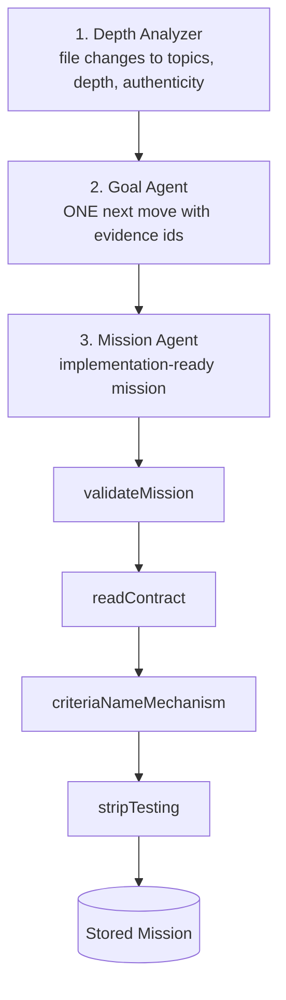

### Mission Agent guarantees


- **At most 5 files**, all implementation; `modifyPaths` includes the start file
- **Exactly 3 acceptance criteria**, each an observable test case the platform runs
- **3 to 5 steps**: step 1 opens the start file, the last commits and pushes
- **`grounding.observedNow`**: a verbatim 12-140 char fragment of the real code
- **`contract`**: library, exported names, key format, TTL, lifecycle, error behavior
- **Criteria prove the mechanism**: at least 2 name the required library and assert the interaction, so a trivial local `Map` cannot pass

The developer **never writes tests**. The platform generates them from the criteria and runs them in a sandbox, so verification is independent of the person being verified.

### Self-repairing generation loop

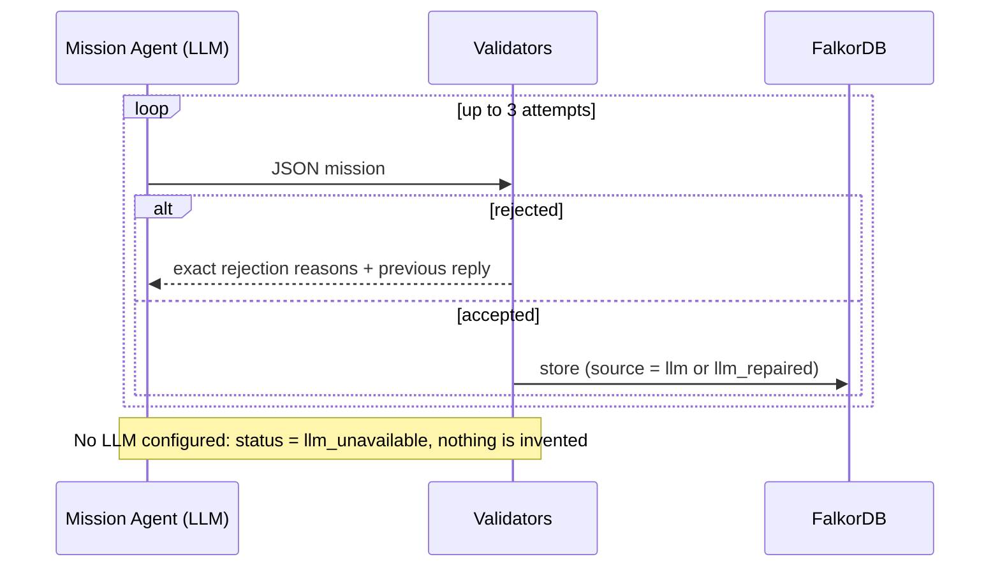

### Grounding: the gap probe

Before the agent may claim "your code lacks X", Pathway checks `package.json` dependencies, the start file text, and file paths. If anything matches, the agent must describe what the code actually shows instead of claiming a gap.

---

## 🧰 Chat agent tools

16 typed tools, each declaring `name`, `description`, `whenToUse`, the FalkorDB `features` it uses, and a parameter schema. That one declaration feeds the **planner**, the **argument validator** (`parseToolArgs` clamps numbers, enforces enums, drops unknown keys), and the **UI**.

| Tool | Graph capability |
|---|---|
| `profile_overview` | DepthAssessment roll-up, PageRank/betweenness ordering |
| `strongest_topics` | Depth levels and graph position |
| `find_gaps` | Gaps relative to graph structure |
| `recommend_next_topics` | `BUILDS_ON` traversal + `KNOWS_TOPIC` join |
| `learning_path_to_topic` | `BUILDS_ON*1..4` traversal |
| `rank_foundations` | `algo.pageRank` |
| `find_bridges` | `algo.betweenness` |
| `knowledge_communities` | `algo.labelPropagation` |
| `connect_topics` | `shortestPath` between topics |
| `explore_neighborhood` | Neighborhood queries |
| `connectivity_check` | Structural connectivity |
| `explain_topic` | Topic detail and context |
| `compare_topics` | Side-by-side structural comparison |
| `search_topics` | Full-text index on `Topic` |
| `audit_authenticity` | Genuine vs. superficial usage |
| `recent_activity` | `last_seen` reads: active vs. gone quiet |

> The chat agent reads the **Topic graph** only.

Every call runs through `runTool` with a **20 s timeout** and returns a `ToolRun` with the result, latency, and a plain-language `how[]` trail. Tools return structured UI blocks (`roadmap`, `ranking`, `groups`, `timeline`, `stats`, `callout`): the LLM narrates, the graph supplies the facts.

---

## 🧱 Tech stack

| Layer | Technology |
|---|---|
| Graph database | **FalkorDB** (Docker), Cypher, built-in graph algorithms |
| Backend | Node.js, TypeScript (ESM) |
| AI | LLM agents (Groq, Cerebras, NVIDIA) with validator and repair loops |
| Frontend | **React**, **React Three Fiber** + drei (3D Skill City) |
| API | Express (REST + SSE) |
| GitHub access | **GitHub MCP server** (Docker, stdio) via the Model Context Protocol client SDK |
| Verification | Platform-generated tests run in a Daytona sandbox |
| Infra | Docker |

---

## 🚀 Setup instructions

### Prerequisites

- **Node.js** 20+ and **npm** (or pnpm / yarn)
- **Docker** (runs FalkorDB **and** the GitHub MCP server that the backend starts on demand)
- A **GitHub OAuth app** and a **personal access token** (sign-in and commit history)
- At least one **LLM API key** (Groq, Cerebras, or NVIDIA); the Mission Agent will not run without one
- A **Daytona API key** (evaluation sandbox for mission tests)

### 1. Clone

```bash
git clone https://github.com/AymaanPathan/pathway.io.git
cd pathway.io
```

### 2. Start FalkorDB with Docker

FalkorDB requires Redis 8.0+, which is already bundled in the official `falkordb/falkordb` image, so there is nothing else to install. See the [FalkorDB Getting Started guide](https://docs.falkordb.com/getting-started).

**Quickest start** (no authentication, data is lost when the container is removed):

```bash
docker run -p 6379:6379 -p 3000:3000 --rm falkordb/falkordb:latest
```

**Recommended: with a persistent volume** (data survives restarts):

```bash
docker volume create falkordb_data

docker run -d --name falkordb \
  -v falkordb_data:/var/lib/falkordb/data \
  -p 6379:6379 -p 3000:3000 \
  falkordb/falkordb:latest
```

| Port | Purpose |
|---|---|
| `6379` | FalkorDB (Redis protocol), used by the backend |
| `3000` | Built-in FalkorDB Browser at http://localhost:3000 |

> If port `3000` clashes with another service, map the browser elsewhere, e.g. `-p 3001:3000`.

Verify:

```bash
docker exec -it falkordb redis-cli PING
# PONG
```

**Pull the GitHub MCP server image.** The backend launches it with `docker run` whenever it syncs or inspects a repository, so Docker must be running and the image available:

```bash
docker pull ghcr.io/github/github-mcp-server:v1.11.0
```

<details>
<summary><b>Optional: password-protect FalkorDB</b></summary>

```bash
docker run -d --name falkordb \
  -v falkordb_data:/var/lib/falkordb/data \
  -p 6379:6379 -p 3000:3000 \
  -e REDIS_ARGS="--requirepass yourpassword" \
  falkordb/falkordb:latest
```

Then set the same password in your backend `.env`.
</details>

**Or with Docker Compose:**

```yaml
# docker-compose.yml
services:
  falkordb:
    image: falkordb/falkordb:latest
    container_name: falkordb
    ports:
      - "6379:6379"
      - "3000:3000"
    volumes:
      - falkordb_data:/var/lib/falkordb/data
    restart: unless-stopped

volumes:
  falkordb_data:
```

```bash
docker compose up -d
```

### 3. Configure the backend

```bash
cd backend
cp .env.example .env
```

```env
# --- GitHub ---
GITHUB_PERSONAL_ACCESS_TOKEN=ghp_xxx
GITHUB_CLIENT_ID=your_oauth_client_id
GITHUB_CLIENT_SECRET=your_oauth_client_secret
GITHUB_OAUTH_CALLBACK_URL=http://localhost:4000/auth/github/callback
GITHUB_EXCLUDE_REPOS=            # optional: repositories to skip during analysis

# --- Auth and URLs ---
SESSION_JWT_SECRET=change_me_to_a_long_random_string
FRONTEND_URL=http://localhost:5173

# --- FalkorDB ---
FALKORDB_URL=redis://localhost:6379
# with a password: redis://:yourpassword@localhost:6379

# --- LLM providers ---
GROQ_API_KEY=gsk_xxx
GROQ_MODEL=your_groq_model
CEREBRAS_API_KEY=csk_xxx
NVIDIA_API_KEY=nvapi_xxx

# --- Evaluation sandbox ---
DAYTONA_API_KEY=your_daytona_key

# --- Depth Analyzer LLM throttling ---
DEPTH_LLM_CONCURRENCY=2          # parallel LLM calls
DEPTH_LLM_TPM=60000              # tokens-per-minute budget
DEPTH_LLM_RETRIES=1              # retries per failed call
DEPTH_LLM_BREAKER=6              # consecutive failures before the circuit breaker opens
```

| Variable | Purpose |
|---|---|
| `GITHUB_CLIENT_ID`, `GITHUB_CLIENT_SECRET`, `GITHUB_OAUTH_CALLBACK_URL` | GitHub OAuth app used for sign-in. Create one at **GitHub, Settings, Developer settings, OAuth Apps** and set its callback URL to match. |
| `GITHUB_PERSONAL_ACCESS_TOKEN` | GitHub token handed to the GitHub MCP server (read-only tools) |
| `GITHUB_EXCLUDE_REPOS` | Optional list of repositories to leave out of the analysis |
| `SESSION_JWT_SECRET` | Secret used to sign session tokens |
| `FRONTEND_URL` | Frontend origin (CORS and OAuth redirects) |
| `FALKORDB_URL` | Connection URL for FalkorDB |
| `GROQ_API_KEY`, `GROQ_MODEL`, `CEREBRAS_API_KEY`, `NVIDIA_API_KEY` | LLM providers for the agents |
| `DAYTONA_API_KEY` | Daytona sandbox where the platform runs its generated tests |
| `DEPTH_LLM_*` | Rate limiting and failure handling for the Depth Analyzer's LLM calls |

Optional: `LLM_TIMEOUT_MS` (Mission Agent timeout, default `30000`) and `MISSION_DEBUG=1` (log every successful mission query; failures always log).

<details>
<summary><b>Optional: sync tuning</b></summary>

All have sensible defaults.

| Variable | Default | Purpose |
|---|---|---|
| `GITHUB_HISTORY_DAYS` | `365` | How far back to analyze |
| `GITHUB_MAX_INITIAL_COMMITS_PER_REPO` | `60` | First-sync cap per repository |
| `GITHUB_MAX_INITIAL_COMMITS_TOTAL` | `400` | First-sync cap overall |
| `GITHUB_SYNC_OVERLAP_DAYS` | `7` | Overlap window for incremental syncs |
| `GITHUB_CONCURRENCY` | `10` | Repositories processed in parallel |
| `GITHUB_COMMIT_CONCURRENCY` | `12` | Commits fetched in parallel |
| `GITHUB_FETCH_PRS` | `true` | Fetch pull requests |
| `GITHUB_FETCH_PR_DETAILS` / `GITHUB_FETCH_PR_FILES` | `false` | One extra MCP call per PR, off for fast onboarding |
| `GITHUB_FETCH_ACTIVITY` | `true` | Issues opened and pull requests reviewed |
| `GITHUB_MAX_PATCH_CHARS` | `60000` | Diff size stored per file |
| `GITHUB_MAX_ADDED_CODE_CHARS` | `40000` | Added-code size stored per file |
| `GITHUB_REPO_CONTEXT_REFRESH_DAYS` | `7` | How often README and manifests are refreshed |
| `FALKORDB_BATCH_SIZE` | `500` | Rows per batched write |
| `FALKORDB_FILECHANGE_BATCH_SIZE` | `40` | FileChange rows per write batch |
| `GITHUB_SYNC_DEBUG` | `false` | Verbose sync logging |

</details>

### 4. Install and run the backend

```bash
npm install
npm run dev
```

Backend: **http://localhost:4000**. On first run it creates the indexes and the full-text index on `Topic`, and seeds the capability taxonomy.

### 5. Run the frontend

```bash
cd ../frontend
npm install
npm run dev
```

Frontend: **http://localhost:5173**. The 3D Skill City uses `three`, `@react-three/fiber`, and `@react-three/drei`:

```bash
npm install three @react-three/fiber @react-three/drei
```

### 6. Try the full loop

1. Sign in with GitHub and sync your repositories
2. Run the **analysis** (Depth Analyzer builds `DepthAssessment`s and `KNOWS_TOPIC` edges, then refreshes PageRank, betweenness, communities and WCC)
3. Set a **goal** on the Goal page
4. Get your **next move**, then your **mission**
5. Implement it, push your branch, and let the sandbox verify it
6. Watch the graph grow and the celebration screen appear


---

## 🛠️ Troubleshooting

| Problem | Fix |
|---|---|
| `ECONNREFUSED 6379` | FalkorDB is not running: `docker ps`, then `docker start falkordb` |
| MCP connection fails or sync hangs at `connecting` | The backend starts the GitHub MCP server with `docker run`. Make sure Docker is running and pull the image: `docker pull ghcr.io/github/github-mcp-server:v1.11.0` |
| Sync stops with `rateLimited` | GitHub's rate limit was hit. Progress is checkpointed, so rerun later. Lower `GITHUB_MAX_INITIAL_COMMITS_*` or `GITHUB_COMMIT_CONCURRENCY` to be gentler |
| `learning_failed` after sync | The LLM provider failed during enrichment. GitHub data is already saved; rerun the sync to learn from it |
| Empty foundation ranking | No `BUILDS_ON` edges yet: re-run the analysis so metrics refresh |
| Communities show only "Standalone" | Not enough `RELATED_TOPIC` links; the tool falls back to `Topic.cluster_id` |
| `llm_unavailable` on mission | Set your LLM API keys (`GROQ_API_KEY`, `CEREBRAS_API_KEY`, `NVIDIA_API_KEY`); Pathway will not invent a mission without an LLM |
| `generation_failed` | All 3 repair attempts were rejected: read the rejection notes in the logs |
| "N of M rows matched nothing" in logs | A `MATCH` in a batch write found no node; check that parent nodes were written first |
| Port 3000 already in use | Remap the FalkorDB Browser with `-p 3001:3000` |
| Tool timed out | Tools are capped at 20 s: check graph size and DB health |

---

## 🗺️ Roadmap

- [ ] Team graphs: "who on my team could pair with me on this?" as one query
- [ ] Mission difficulty calibrated from `hops` and readiness
- [ ] Decay-aware recommendations from `last_seen` (refresher missions)
- [ ] More languages and taxonomy coverage

---

## 💡 Design principles

1. **Graph for structure, LLM for judgment**: ordering and readiness come from algorithms
2. **Ground every claim**: verbatim code, gap probes, evidence ids, stored query traces
3. **Independent verification**: platform tests run against developer code
4. **Evidence over assertion**: only verified edges count; inferred edges are labeled
5. **Self-describing tools**: adding a graph tool is a single file

---

<div align="center">

### ⭐ If you like Pathway, please star the repo!

</div>