<div align="center">


### Know what you know. Learn what's next.

**Pathway reads your GitHub history, maps what you already know into a topic knowledge graph, and tells you the one thing worth learning next, and why.**

**Built for the FalkorDB Hackathon**


[🎬 Demo video](https://www.youtube.com/watch?v=Pc49zZzByUw) · [📝 Blog post](https://medium.com/@aymaanpathan5/pathway-we-turned-github-history-into-a-knowledge-graph-that-assigns-you-your-next-coding-mission-2c240a2bf45e) · [Report a bug](../../issues)

</div>

---

## 📖 What is Pathway?

Most learning advice starts from a blank page: "pick a language, follow a roadmap." Pathway starts from **you**.

It reads your GitHub coding history and builds a **Topic Graph** of the engineering topics you have actually worked on, how those topics depend on each other, and how deeply you know each one, graded from your own code. Then it answers the question that matters most when you want to grow:

> **Given what I already know, what should I learn next?**

The recommendation is not a tutorial list. It is a specific topic that sits at the edge of your knowledge (its prerequisites are met, it builds on what you already use) plus a small, concrete practice task in your own repository, verified by platform-run tests, so the new knowledge is proven rather than self-reported.

The Topic Graph answers four questions that a list of tutorials cannot:

1. **What do I know?** A `DepthAssessment` per topic, backed by real file changes, with a confidence and an authenticity verdict.
2. **What is ready for me?** The *learning frontier*: topics just above your level whose required prerequisites you already meet.
3. **What is in my way?** Missing foundations on the path to a topic, listed in the order to learn them.
4. **How do I learn it?** A `NextMove` anchored to a real file and a visible gap in your code, turned into a `Mission` with acceptance criteria.

> **Graph for structure, LLM for judgment.** FalkorDB supplies topics, prerequisites, ranks, evidence and traversals. LLM agents classify, judge and write. Every LLM output passes validators that check it against the graph before it is stored.

| Typical learning tools | Pathway |
|---|---|
| Start from a generic roadmap | Start from **what you have already built** |
| Self-rated skills or quiz scores | Depth derived from **real file changes** (`DepthAssessment` → `BACKED_BY` → `FileChange`) |
| "Top 10 tutorials" | **One next topic**, with the reason it is next |
| Flat skill lists | A **prerequisite graph** with a written reason on every edge |
| Same advice for everyone | A frontier computed from **your** levels and **your** gaps |
| Checkbox completion | Learning counts only when criteria are **verified against the diff** and CI is acceptable |
| Opaque scoring | **FalkorDB algorithms** (PageRank, betweenness, label propagation, WCC) plus stored query traces |

---

## 🎬 Demo and write-up

- **Demo video:** [https://www.youtube.com/watch?v=Pc49zZzByUw](https://www.youtube.com/watch?v=Pc49zZzByUw)
- **Blog post:** [How Pathway turns GitHub history into a knowledge graph](https://medium.com/@aymaanpathan5/pathway-we-turned-github-history-into-a-knowledge-graph-that-assigns-you-your-next-coding-mission-2c240a2bf45e)

---

## 📑 Table of contents

1. [How Pathway decides what you learn next (worked example)](#-how-pathway-decides-what-you-learn-next)
2. [Architecture](#%EF%B8%8F-architecture)
3. [The Topic Graph](#%EF%B8%8F-the-topic-graph)
4. [Understanding what you know: discovery and depth](#-understanding-what-you-know)
5. [Finding what to learn next: the learning frontier](#-finding-what-to-learn-next)
6. [Learn-Next recommendation (Goal Agent)](#-learn-next-recommendation-goal-agent)
7. [Learn by doing: missions and verification](#%EF%B8%8F-learn-by-doing-missions-and-verification)
8. [The feedback loop: learning updates the graph](#-the-feedback-loop)
9. [Chat agent: ask what to learn](#-chat-agent)
10. [Evidence layer](#-evidence-layer-capabilities-detectors-experiences)
11. [Journey view and 3D Skill City](#%EF%B8%8F-journey-view-and-3d-skill-city)
12. [GitHub MCP server and sync pipeline](#-github-mcp-server-and-sync-pipeline)
13. [Tech stack](#-tech-stack)
14. [Setup instructions](#-setup-instructions)
15. [Troubleshooting](#%EF%B8%8F-troubleshooting)
16. [Limitations](#-limitations)
17. [Design principles](#-design-principles)

---

## 🧭 How Pathway decides what you learn next

This section follows **one recommendation** from your code to your next lesson.

> **What is real and what is illustrative.** The mechanisms, queries, function names, fields and rules below are the ones in the code. The topic slugs, scores, file paths and quoted lines are **illustrative values** for a developer who built BullMQ workers. Topics are **discovered per developer** by the Depth Analyzer, so slugs differ between developers. Capabilities, detector rules and completion criteria are **seeded** and identical for everyone. Replace the example values with output from your own run (see [step 7 of setup](#7-reproduce-the-recommendation-on-your-own-data)).

**What the developer asked:** *"make my background jobs reliable"* (or simply: *"what should I learn next?"*)

```mermaid
flowchart LR
    CODE[(FileChange<br/>added_code, imports, symbols)] --> DET[Detector rules]
    DET --> DEM[Demonstration<br/>job_queue_workers]
    DEM -->|OF_CAPABILITY| CAP[Capability<br/>job_queues]
    CAP -->|MAPS_TO| TOP[Topic<br/>background_job_processing<br/>level: working]
    TOP -->|RELATED / BUILDS_ON| FR[Learning frontier<br/>error_handling_and_retries<br/>prerequisites met]
    FR --> GG[Goal graph<br/>retrieve, rank, read code]
    GG --> NM[Learn-next move<br/>dead-letter handling]
    NM --> M[Practice mission<br/>3 criteria]
    M --> V{Verified?}
    V -->|yes| VD[Demonstration source=mission]
    VD -->|EVIDENCE_FOR_TOPIC| TOP
    VD -.->|marks stale| DA[Re-grade topic]
```

### Step 1: what you already know

```cypher
MATCH (:Developer {id: $dev})-[:ASSESSED]->(a:DepthAssessment {topic_slug: $slug})
RETURN a.level, a.score, a.confidence, a.authenticity, a.verdict, a.rationale,
       a.evidence_band, a.dimensions_json, a.stale
```

```text
topic:         background_job_processing
level:         working   (score 34, band 20-39)      baseline: working (31)
confidence:    medium    authenticity: genuine_implementation
evidence:      8 files, 6 commits, 1 repository      band: moderate
safeguards:    retry policy, bounded worker concurrency
rationale:     Observed: S1 builds a Worker with attempts and backoff options and a
               concurrency limit. Observed: D1 is a job_queue_workers detection at
               implementation depth. Inferred: retry settings were tuned after C3 (fix).
               Associated: redis is present as a dependency only.
               [Confidence medium: 8 files, 6 commits, 1 repository; 3 of 4 evidence
               kinds; no related tests seen; single-repository evidence cannot be high]
gaps:          no failed-job handling observed
```

The rationale separates `Observed:`, `Inferred:` and `Associated:` statements. Only observed statements, each citing a ref (`S1` code sample, `D1` detection, `E1` experience, `C1` commit), count as evidence. Every cited ref maps to real graph nodes through `BACKED_BY`.

### Step 2: what the topic rests on, and what you are missing

The walk is a breadth-first traversal over `BUILDS_ON` edges held in memory (one cached read of the taxonomy), up to 3 hops for prerequisites and 2 for "unlocks".

```ts
const lg = await readTopicLearningGraph(graph, developerId, "background_job_processing");
// lg.prerequisites, lg.unlocks, lg.related, lg.capabilityPaths, lg.readiness
```

| Prerequisite | Hops | Strength | Edge reason (excerpt) | Your level | Met |
|---|---|---|---|---|---|
| `redis_data_structures` | 1 | required | the queue stores jobs in Redis lists and sorted sets | proficient | yes |
| `asynchronous_programming` | 1 | required | workers process jobs concurrently off the request path | proficient | yes |
| `error_handling_and_retries` | 1 | helpful | failed jobs need classification before a retry policy applies | surface | no (not blocking: helpful) |

`readiness.ready` is true when no **required** prerequisite on a required path is below `working`. When something *is* blocking, `readiness.learningOrder` lists the blocking foundations deepest first: that is the order to learn them in.

### Step 3: what "done well" looks like

`COMPLETION_CRITERIA` (seeded as `TechniqueSpec` / `Safeguard` nodes) defines what a successful implementation of each technique contains. For `job_queue_workers`:

| Safeguard | Required | Observed in your code |
|---|---|---|
| retry policy | yes | yes |
| bounded worker concurrency | yes | yes |
| failed-job / dead-letter handling | yes | **no** |
| job de-duplication | no | no |

`evaluateCapabilityCompletion("job_queues", demos)` reports the technique as **not met**: depth was reached, but a required safeguard was never observed. That missing safeguard is the real, checkable thing to learn next.

### Step 4: the recommendation (Goal graph, then Goal Agent)

`buildGoalGraph` retrieves a neighbourhood around what you know and `planGoal` asks the LLM to choose **one** thing to learn. The graph never chooses.

```text
resolution:  method=full_text, seeds=[background_job_processing]
retrieval:   RELATED_TOPIC up to 2 hops + same-cluster topics, depth per topic,
             MAPS_TO capability coverage (demonstrations per capability),
             evidence E1..En with real code excerpts, newest file versions
ranking:     Personalized PageRank (restart on seeds) orders the retrieved nodes
LLM draft:   focus=background_job_processing, capability=job_queues, reuseId=E1
             observedInCode: <12-140 char verbatim line from E1's code>
             failureScenario: a job that exhausts its attempts is dropped and
                              nothing records or surfaces it
validators:  quote must be verbatim in the code, failure must be concrete (40+ chars),
             no "nice-to-have" reasoning, files must exist in the evidence,
             no repeat of a previous or verified mission
```

The accepted recommendation is stored by `storeNextMove`:

```text
(Goal)-[:PROPOSES]->(NextMove {title, summary, done_when, details_json})
(NextMove)-[:FOCUSES_ON]->(Topic)   (NextMove)-[:ADVANCES]->(Capability)
(NextMove)-[:STARTS_AT]->(FileChange)
(NextMove)-[:BACKED_BY {ref}]->(Demonstration | FileChange | DepthAssessment)
(NextMove)-[:LEVERAGES|CLOSES_GAP_IN]->(Topic)
```

`LEVERAGES` points at topics you already know and will build on; `CLOSES_GAP_IN` points at the topic whose gap the lesson fills. A topic can be claimed as a strength only if the recommendation cites evidence that belongs to that topic; otherwise the link is dropped and reported in `rejected`.

### Step 5: the practice mission

The Mission Agent turns the recommendation into an implementation-ready task in your own repository: at most 5 files, exactly 3 acceptance criteria written as test cases, a `contract` of decisions you must not guess (library, exported names, key format, TTL, error behavior), and a verbatim `grounding.observedNow` fragment from the pinned code. At least 2 criteria name the required library and assert the interaction with it, so a trivial local stub cannot pass. You write the implementation; the platform writes and runs the tests.

`Mission.explanation_json` stores the real queries that loaded the recommendation (relationship pattern, Cypher, row counts, timings). Nothing in that trace is reconstructed afterwards.

### Step 6: the graph learns with you

When a mission is **verified**, the platform writes a `Demonstration {source: "mission"}`, links it to the topic with `EVIDENCE_FOR_TOPIC {source: "mission_verified"}`, and flags the topic's `DepthAssessment` as `stale`. Only that topic needs to be re-graded, and then the frontier moves forward. See [the feedback loop](#-the-feedback-loop).

---

## 🏗️ Architecture

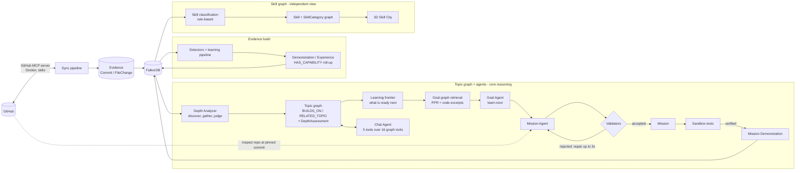

> The **Skill graph** (3D city) is independent of the **Topic graph**. Both read the same evidence. The Journey view reads the **capability** layer.

---

## 🕸️ The Topic Graph


The graph lives in **FalkorDB** and is queried with **Cypher**. Every write is an idempotent `MERGE` keyed on `id`, so re-running any stage is safe.

<p align="center">

  <br/>
  <sub><b>The real graph in FalkorDB Browser:</b> one developer's demonstrations, the capabilities they prove, and the file changes behind them.</sub>
</p>


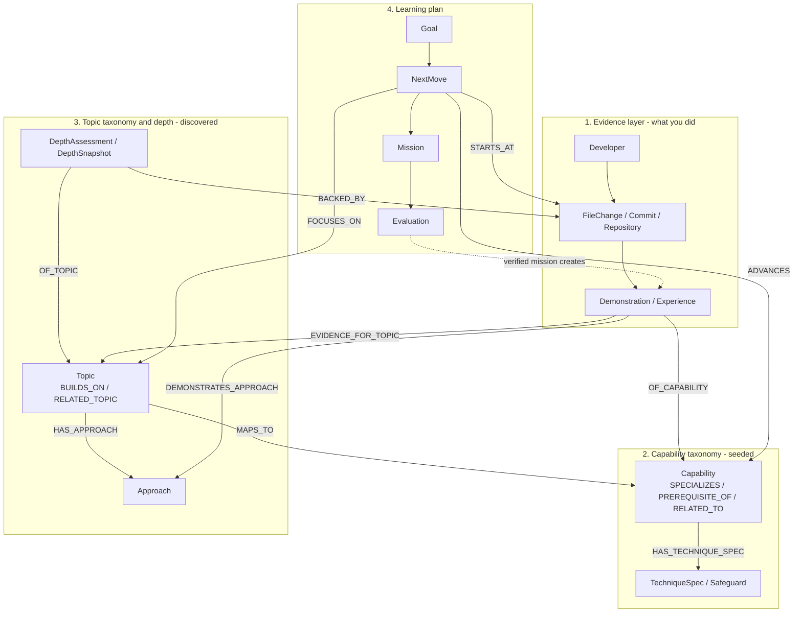

**Seeded vs. discovered.** Capabilities (20 learnable, 8 domains), detector rules (21), technique specs and safeguards are defined in code and written by `ensureCapabilityGraph`, which is stamped with a definitions version and re-seeds only when the definitions change. **Topics are not seeded.** They are proposed from your evidence by the Depth Analyzer, validated against it, and shared in one taxonomy across developers. No developer data is stored on a `Topic`.

### Layer 3: Topics, approaches and depth

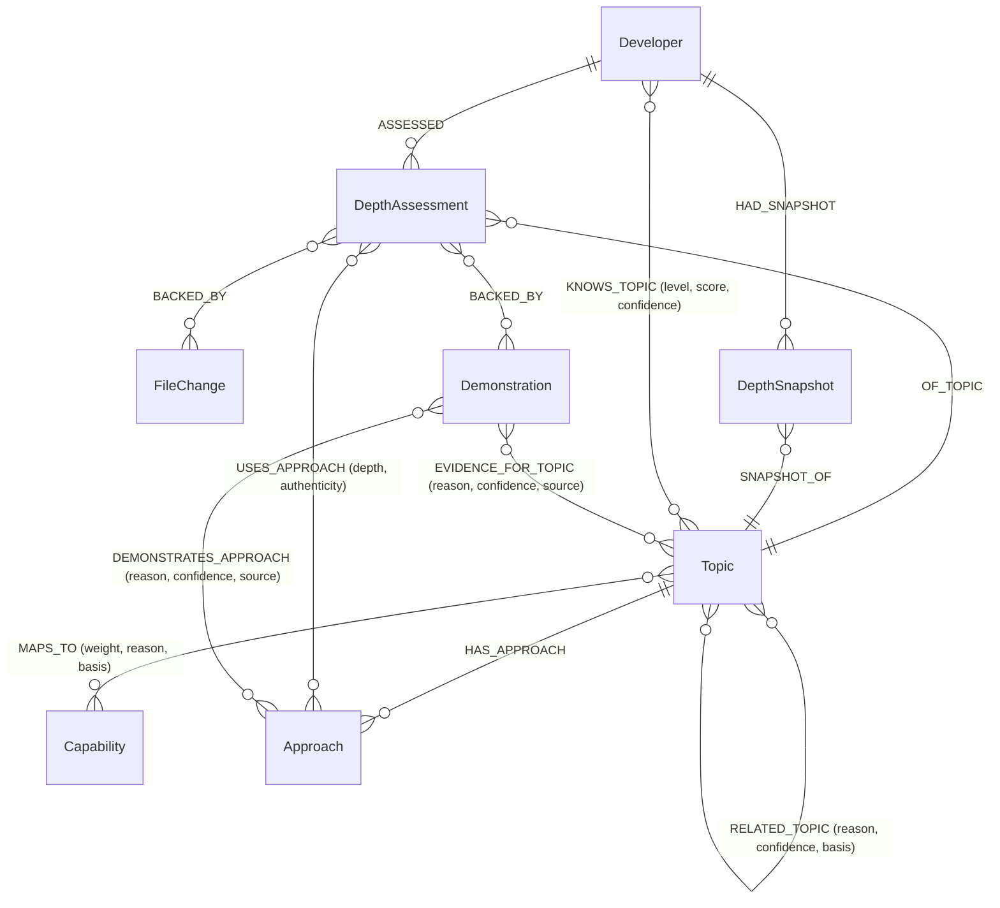

`Topic` properties: `id` (`topic:<slug>`), `slug`, `name`, `domain` (`frontend | backend | database | infrastructure | ai_ml | mobile | general`), `description`, `aliases_text`, `stub`, plus **algorithm results written onto the node**:

| Property | Written by | What it means for learning |
|---|---|---|
| `foundation_rank` | `algo.pageRank` over `BUILDS_ON` (falls back to `RELATED_TOPIC`) | How foundational a topic is: high-rank topics unlock the most |
| `bridge_score` | `algo.betweenness` | Topics that connect otherwise separate areas of your knowledge |
| `cluster_id` | `algo.labelPropagation` over `RELATED_TOPIC` | The neighbourhood a topic belongs to |
| `component_id` | `algo.WCC` | Knowledge that sits in disconnected islands |

**Edge semantics.** `(advanced)-[:BUILDS_ON]->(prerequisite)`: the target should be understood *before* the source. `strength` is `required` or `helpful`. `RELATED_TOPIC` is stored symmetric. Writers enforce:

- `BUILDS_ON` must stay a **DAG**; an edge that would close a cycle with any existing `BUILDS_ON` is rejected.
- Every edge needs a **specific rationale** (a real sentence of 8+ words that says why); templates such as "X builds on Y" are rejected.
- A `RELATED_TOPIC` between topics already linked by `BUILDS_ON` is rejected.
- A later assertion replaces the stored rationale only when it is at least as confident.
- A foundation the model names without an assessment is stored as an **unassessed stub** topic, so the edge is not lost.

**`DepthAssessment`** (one per developer and topic) carries `level`, `level_rank`, `score`, `baseline_score`, `confidence`, `authenticity`, `verdict`, `rationale`, `strengths_json`, `gaps_json`, `safeguards_json`, `implementations_json`, `approaches_json`, `evidence_json`, `stats_json`, `spec_json`, `dimensions_json`, `evidence_band`, `is_current`, `stale`, `fallback`, `model`, `build_id`, plus counts and `first_seen` / `last_seen`. One immutable `DepthSnapshot` per build keeps history, so you can see how your knowledge changed over time.

| Depth level | Rank | Score band |
|---|---|---|
| `none` | 0 | 0 |
| `surface` | 1 | 1 – 19 |
| `working` | 2 | 20 – 39 |
| `proficient` | 3 | 40 – 64 |
| `deep` | 4 | 65 – 100 |

**Authenticity** (was it built, or only present?): `genuine_implementation`, `working_usage`, `incidental`, `boilerplate`, `insufficient_evidence`. **Confidence** (`high | medium | low`) describes the *evidence*, not the skill. It is stored separately from depth, along with an **evidence band** (`none | sparse | moderate | rich`) and informational dimensions (implementation complexity, approach coverage, safeguards, independent implementations, repeated application, recency).

### Layer 1: Evidence

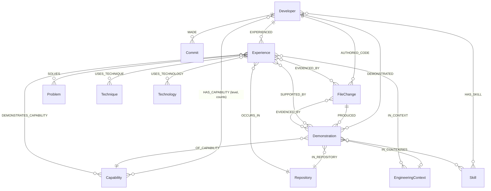

> **Verified vs. inferred.** Only edges produced from your own code count as evidence. Structural edges are `basis = "declared"`; anything guessed from goal text or similarity is `basis = "inferred"` and can never satisfy a prerequisite. `Topic -[:MAPS_TO]-> Capability` is taxonomy: it selects which demonstrations to read and is **never proof of skill**.

### Layer 4: Goal, NextMove, Mission, Evaluation

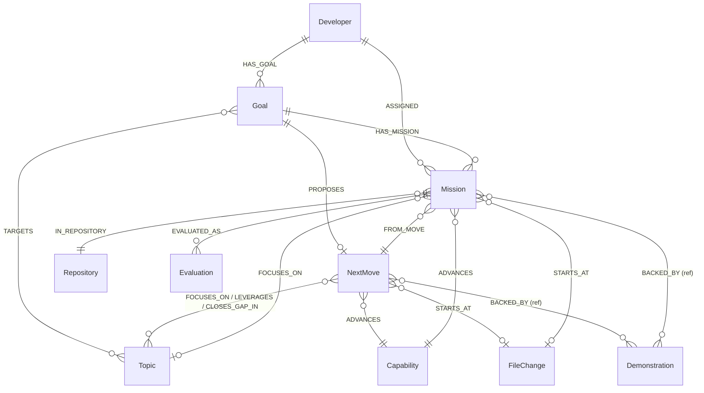

| Node | Key properties |
|---|---|
| `Goal` | `id`, `developer_id`, `wish`, `resolved_by` |
| `NextMove` | `title`, `summary`, `done_when`, `details_json` (decision, challenge, startingPoint, steps) |
| `Mission` | `status`, `verification_state`, `repository`, `branch`, `base_commit`, `start_path`, `capability_id`, `focus_slug`, `spec_json`, `pin_json`, `explanation_json`, `fork_repository`, `work_branch` |
| `Evaluation` | `verdict`, `head_commit`, `ci_state`, `results_json`, `scope_warnings_json`, `changed_files_json`, `verified`, `verification_reasons_json` |

A `Mission` keeps a **full snapshot** of the recommendation it came from, because planning a new one replaces the goal's `NextMove`. Mission `status` moves through `proposed → in_progress → submitted → completed | needs_work`, or `abandoned`.

### Indexes

```cypher
CREATE INDEX FOR (n:Topic) ON (n.id)
CREATE INDEX FOR (n:Topic) ON (n.slug)
CREATE INDEX FOR (n:Approach) ON (n.id)
CREATE INDEX FOR (n:DepthAssessment) ON (n.id)
CREATE INDEX FOR (n:DepthAssessment) ON (n.developer_id)
CREATE INDEX FOR (n:DepthAssessment) ON (n.topic_slug)
CREATE INDEX FOR (n:DepthSnapshot) ON (n.id)
CREATE INDEX FOR (n:Developer) ON (n.id)
CREATE INDEX FOR (n:Capability) ON (n.id)
CREATE INDEX FOR (n:Demonstration) ON (n.id)
CREATE INDEX FOR (n:Experience) ON (n.id)
CREATE INDEX FOR (n:Goal) ON (n.id)
-- plus Commit, FileChange, Repository, Technique, Technology, TechniqueSpec, Safeguard ...

CALL db.idx.fulltext.createNodeIndex('Topic', 'name', 'description', 'aliases_text')
CALL db.idx.fulltext.createNodeIndex('Capability', 'name', 'description', 'keywords')
CALL db.idx.fulltext.createNodeIndex('Demonstration', 'summary', 'snippet', 'commit_subject')

-- created by sync ingestion
CALL db.idx.fulltext.createNodeIndex('Commit', 'message')
CALL db.idx.fulltext.createNodeIndex('FileChange', 'path', 'added_code')
CALL db.idx.fulltext.createNodeIndex('PullRequest', 'title', 'body')
CALL db.idx.fulltext.createNodeIndex('Issue', 'title', 'body')
```

---

## 🔬 Understanding what you know

Before Pathway can say what is next, it has to know where you are. The Depth Analyzer (`analyzeDeveloperDepth`) turns your evidence into topics and judges each one.

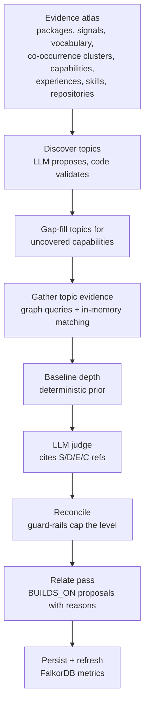

1. **Evidence atlas.** One read of your authored file changes (keyset-paginated), capabilities, experiences, skills, repositories and demonstrations. Packages, signals and vocabulary are counted; a deterministic label-propagation groups atoms that are used together.
2. **Discovery, grounded.** The LLM may only use packages, signals and capability ids copied from the atlas, and keywords found in the atlas vocabulary. Anything else is discarded and reported. A topic with no remaining supporting atom is dropped. The `domain` must be one of the controlled domains; otherwise a deterministic `inferDomain` classifies it. Capability coverage is computed and gaps are filled from the capability list.
3. **Gather.** For each topic: matched files (packages, signals, symbol and path keywords), scaffold-commit detection, maturation (revisited files, follow-up fix/perf/refactor commits), declared-but-never-imported packages, hardening behaviours, code samples, demonstrations (read via `MAPS_TO`, with text-only matches capped at `usage`) and a footprint (commits, repositories, directories) used to relate topics by real overlap.
4. **Baseline.** `computeBaselineDepth` sums capped components (volume, breadth, commits, sustained work, repositories, own implementation, hardening, maturation, tests, approach diversity) and applies caps (scaffold-heavy evidence ×0.6, one commit ≤ 25, one file ≤ 20). Every reduction is listed in `caps`.
5. **Judge.** The LLM judges depth, authenticity and confidence from cited refs and may ask for more evidence by naming real packages or keywords (verified with an in-memory probe and a full-text probe on `FileChange.added_code`).
6. **Reconcile (guard-rails).** The model may not exceed the baseline by more than one level; counts alone cannot exceed `working` without own code, hardening, revisits or tests; `deep` needs a built mechanism; authenticity caps the level (for example `boilerplate` cannot exceed `surface`); confidence is capped by how strong **and varied** the evidence is. Without an LLM the level never exceeds `proficient` and confidence is `low`. Every applied guard-rail is appended to the rationale.
7. **Relate.** A separate pass proposes prerequisite links among the final topics; each must carry a specific reason and pass the DAG and rationale checks. Evidence-overlap `RELATED_TOPIC` edges are derived from shared commits, directories, capabilities and packages.
8. **Persist.** Strict writes (a missed `MATCH` aborts before stale cleanup), `ASSESSED`, `OF_TOPIC`, `USES_APPROACH`, `BACKED_BY`, `KNOWS_TOPIC`, `DepthSnapshot`, evidence links, then `refreshTopicGraphMetrics`.

The LLM layer goes through one shared governor per model (requests and tokens per minute, 429 handling), with a concurrency pool and a circuit breaker that pauses 30 seconds after repeated failures. Judgements and discoveries are cached per developer and fingerprint, so unchanged code is not re-judged.

`reanalyzeTopicDepth` recomputes **one** topic from its stored `spec_json`; `relinkTopicTaxonomy` rebuilds relations from stored specs without calling the LLM.

---

## 🧮 Finding what to learn next

"What next?" is answered from graph position, not an LLM-invented score. The central idea is the **learning frontier**: the topics you do not yet know well whose required foundations you already have.

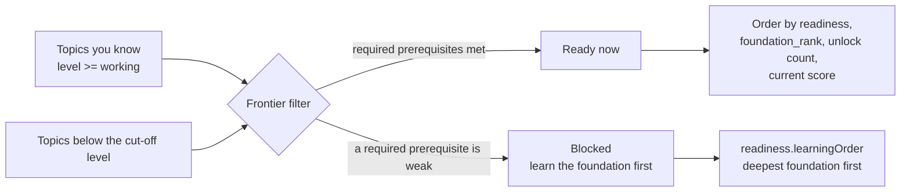

| Question | How it is computed | Stored as / used by |
|---|---|---|
| **What is ready for me?** | Topics below the cut-off level whose required prerequisites are met, ordered by readiness, `foundation_rank`, unlock count, current score | `readLearningFrontier` |
| **What must I learn before X?** | Breadth-first walk of `BUILDS_ON` in memory, up to 3 hops, each hop carrying its edge reason | `readTopicLearningGraph` |
| **What does learning X unlock?** | The same walk in reverse, up to 2 hops | `readTopicLearningGraph` |
| **How do X and Y connect?** | Cypher `shortestPath` over `BUILDS_ON\|RELATED_TOPIC*1..6`, tried in both directions | path with hop types |
| What are my foundations? | `algo.pageRank('Topic', 'BUILDS_ON')` (falls back to `RELATED_TOPIC`) | `foundation_rank` |
| What connects my skills? | `algo.betweenness` over `BUILDS_ON` + `RELATED_TOPIC` | `bridge_score` |
| What do I work on together? | `algo.labelPropagation` over `RELATED_TOPIC` (10 iterations) | `cluster_id` |
| Which areas are disconnected? | `algo.WCC` | `component_id` |
| Which evidence ties a topic to my code? | `Topic -[:MAPS_TO]-> Capability <-[:OF_CAPABILITY]- Demonstration` for one developer, plus `EVIDENCE_FOR_TOPIC` | `readTopicGraphEvidence` |

Metrics refresh safely: each metric is computed, written, and **only then** are stale values of that metric removed, so a failed run leaves the previous ranks intact. The result reports `status` (`ok | partial | failed | empty_graph`), the algorithms that ran and any failures. The taxonomy is small (hundreds of topics), so it is read once, cached for a short TTL, and traversed in memory; writers invalidate the cache.

### What relationships buy you

**1. A prerequisite walk exposes a missing foundation.** `readTopicLearningGraph` marks a prerequisite `blocking` when it is required, on a required path, and below `working`. Instead of "go learn Kubernetes," you get "learn X first, because Y needs it, and you have not shown X."

**2. Shortest path connects what you know to what you want.** `connect_topics` returns the route and the type of every hop, so an association (`RELATED_TOPIC`) is never presented as a prerequisite (`BUILDS_ON`).

**3. Communities reveal adjacent areas.** `labelPropagation` clusters topics; `WCC` flags knowledge that sits in disconnected islands. The goal graph adds same-cluster topics as weak (weight 0.25) neighbours, so recommendations lean toward areas next to what you already do.

**4. Foundations and unlocks rank the options.** When several topics are ready, the ones with higher `foundation_rank` and more unlocks come first, because learning them opens the most further topics.

<details>
<summary><b>Prerequisite roadmap query (Cypher form)</b></summary>

```cypher
MATCH path = (t:Topic {slug: $slug})-[:BUILDS_ON*1..3]->(f:Topic)
WITH f, min(length(path)) AS hops
OPTIONAL MATCH (:Developer {id: $dev})-[k:KNOWS_TOPIC]->(f)
RETURN f.slug AS slug, hops,
       coalesce(k.level, "none") AS level,
       coalesce(k.level_rank, -1) AS rank
```
</details>

<details>
<summary><b>Community detection</b></summary>

```cypher
CALL algo.labelPropagation({
  nodeLabels: ['Topic'],
  relationshipTypes: ['RELATED_TOPIC'],
  maxIterations: 10
})
YIELD node, communityId
RETURN node.id AS id, communityId
```
</details>

---

## 🎯 Learn-Next recommendation (Goal Agent)

`planGoal` turns the frontier into **one concrete thing to learn**. It has two halves: **`buildGoalGraph` retrieves and ranks; the LLM decides; validators check the decision against the graph.**

```mermaid
flowchart TD
    W[Your goal or "what next?"] --> R[1. Resolve seeds<br/>agent topics, exact name,<br/>domain, full-text]
    R --> X[2. Expand<br/>RELATED_TOPIC up to 2 hops<br/>+ same-cluster peers]
    X --> Q[3. Read<br/>depth, capability coverage,<br/>evidence, completed missions]
    Q --> C[Read code excerpts<br/>of the strongest evidence]
    Q --> P[4. Personalized PageRank<br/>over the retrieved subgraph]
    P --> S[5. Signals<br/>strengths, unproven, opportunities]
    C --> L[LLM chooses ONE thing to learn]
    S --> L
    L --> F{finalize<br/>validators}
    F -->|rejected: up to 2 repairs| L
    F -->|accepted| N[storeNextMove]
```

| Input to the agent | Where it comes from |
|---|---|
| Seeds | Topics named by the goal agent (must exist as `Topic` nodes), an exact `Topic` name/slug match, a whole-area `domain`, or the `Topic` full-text index; a vague wish is mapped to existing slugs by a small LLM call, never invented |
| Neighbourhood | `RELATED_TOPIC` up to 2 hops (one query per hop, so each edge keeps its reason) plus topics sharing `cluster_id` |
| Your depth | `Developer -[:ASSESSED]-> DepthAssessment -[:OF_TOPIC]-> Topic` (level, authenticity, approaches, gaps, safeguards, what was built) |
| Capability coverage | `Topic -[:MAPS_TO]-> Capability` with the count of your demonstrations per capability (zero means "no evidence found", not "cannot do it") |
| Evidence | Demonstrations linked by `EVIDENCE_FOR_TOPIC` (confidence ≥ 0.3), demonstrations reached through `MAPS_TO`, code cited by assessments (`BACKED_BY`), and files matching the topic's own packages and keywords. Older file versions are marked superseded and the newest change to the same file is added |
| Code | `FileChange.added_code` excerpts for the strongest evidence. **The agent may quote only this code** |
| History | The previous `NextMove` of the goal and the verified missions on these topics, so nothing is repeated |
| Ranking | Personalized PageRank (restart on seeds, damping 0.85), computed in TypeScript over the retrieved topic, assessment, capability, demonstration, file and repository nodes. It orders context; it does not choose what you learn |

**Validation (`finalize`).** The draft must pick evidence that has code behind it; its `observedInCode` must be a verbatim fragment of that code (a real line is substituted if it is not); the failure must be concrete, at least 40 characters, and not rest on practice, flexibility or "the code lacks an option"; steps must be specific; `doneWhen` must be checkable; named files must exist in the evidence; the recommendation must not repeat a technique already demonstrated, the previous one, or a verified mission; and it may not mention earlier work when no history exists. Rejected output is repaired up to twice with the exact reasons. Transport failures (timeouts, 429s, 5xx) are retried separately and never spend repair attempts.

**Statuses.** `planned`, `needs_clarification`, `needs_evidence` (no readable code behind the neighbourhood), `llm_unavailable` (nothing is invented without an LLM) and `generation_failed` (with `stage: "transport" | "validation"`).

The decision trace (`DecisionTrace`) is built from the graph in code, not by the LLM, so you can see **why this topic is next**: the route from your seeds with relationship types and reasons, the assessment, capability and evidence on each path, neighbours of the focus topic, the code that is reused, and the alternative the agent considered.

---

## 🛠️ Learn by doing: missions and verification


Reading about a topic is not the same as learning it. A mission is the smallest real change that makes you use the new idea inside code you already own. `planMission` receives the saved recommendation, the capability it advances, the evidence, and a fresh **inspection of the repository** at a pinned commit (package root, package manager, test runner, nearby files, a gap probe over dependencies, the start file and paths). It does not change the goal, focus or capability.

**Guarantees**

- At most **5 files**, all implementation; `modifyPaths` includes the start file; any new non-test file is in `createPaths`
- Exactly **3 acceptance criteria**, each a test case the platform runs (given / when / then)
- **3 to 5 steps**: step 1 opens the start file, the last commits and pushes; no step mentions tests
- `grounding.observedNow`: a verbatim 12 to 140 character fragment of the current code
- `contract`: library, exported names, key format, TTL, lifecycle, error behavior (3 to 8 concrete decisions)
- At least 2 criteria name the required library and assert the interaction with it
- The mission must keep the saved capability and name the mechanism the Goal Agent selected
- Earlier and verified missions are listed so none is repeated
- You **never write tests**; the platform writes and runs them in a sandbox

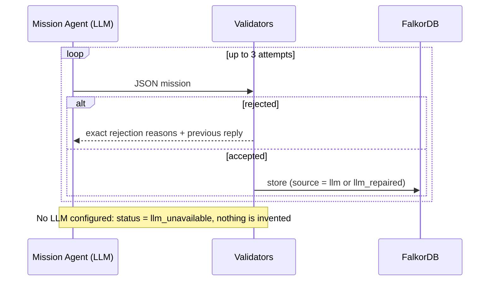

### Three different facts, kept apart

`Mission.verification_state`:

| State | Meaning |
|---|---|
| `assigned` | You were given the task (proposed, in progress, submitted) |
| `evaluated` | The code was assessed; the outcome may still be `needs_work` |
| `verified` | **Every** criterion is met **and** verified against the diff, CI did not fail or stay pending, and a demonstration was extracted |

`verifyEvaluation` is a pure function: verdict `completed`, at least one criterion, all met, all verified (the quote was found in the diff and the check's preconditions held), `ciState` not `failure` or `pending`, and a demonstration present. Only `verified` writes a demonstration and reaches the topic pipeline. A `completed` verdict alone is not proof that you learned something.

---

## 🔁 The feedback loop

Learning should change the map. Each verified mission becomes new evidence, and the frontier moves.

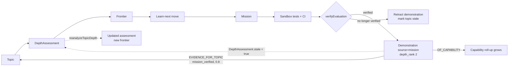

What `recordEvaluation` does:

1. Stores an `Evaluation` and updates the mission's `status` and `verification_state`.
2. **Verified:** creates `Demonstration {id: "demo:<missionId>", source: "mission", depth_rank: 2}` with `DEMONSTRATED` and `OF_CAPABILITY`, links it to the topic with `EVIDENCE_FOR_TOPIC {source: "mission_verified", confidence: 0.8, reason}`, and sets `DepthAssessment.stale = true` with a reason and timestamp. Mission demonstrations survive `cleanupStale` and are included in the capability roll-up on the next evidence build.
3. **A later submission that is no longer verified** deletes that demonstration and marks the topic stale, so earlier credit is retracted.
4. It returns a `MissionTopicUpdate` (`developerId`, `topicSlug`, `capabilityId`, `demonstrationId` or `null` when retracted, `linked`) so the caller can re-grade **only that topic**.

`readStaleTopicAssessments` lists the topics flagged stale, and `reanalyzeTopicDepth` recomputes one topic from its stored spec and the current evidence. The depth update is therefore **targeted and deferred**: the flag is set immediately when a mission verifies, and the new `DepthAssessment` appears when the topic is re-graded. A mission does not set depth directly, and a single mission never claims more than `working`-level evidence.

---

## 🤖 Chat agent

Ask in plain language: *"what should I learn next?"*, *"what am I missing before I can do X?"*, *"how does my caching work relate to my queues?"*. The chat agent reads the **Topic graph**. It exposes **5 public tools** that wrap **16 underlying graph tools**, each declaring its name, `whenToUse`, the FalkorDB features it uses and a parameter schema. One declaration feeds the planner, the argument validator (`parseToolArgs` clamps numbers, enforces enums, drops unknown keys) and the UI.

| Public tool | Wraps (graph capability) |
|---|---|
| **`gap_analysis`** | `find_gaps`, `recommend_next_topics` (prerequisite walk + `KNOWS_TOPIC` join), `learning_path_to_topic` |
| `skill_overview` | `profile_overview`, `strongest_topics`, `search_topics` (full-text), `audit_authenticity`, `recent_activity` |
| `topic_deep_dive` | `explain_topic`, `compare_topics` |
| `topic_connections` | `connect_topics` (`shortestPath`), `explore_neighborhood` |
| `graph_structure` | `rank_foundations` (PageRank), `find_bridges` (betweenness), `knowledge_communities` (label propagation), `connectivity_check` (WCC) |

**How a question is answered**

1. **Plan.** A keyword router handles recognisable questions without a model call; an LLM planner runs only for vague ones or greetings.
2. **Round 1.** Up to 3 tools run in parallel, each with a 20 second timeout.
3. **Round 2.** A follow-up runs only when round 1 leaves a concrete open question (for example, a gap was flagged, so the upper topic is explained and its prerequisite path is checked). It is chosen by code from the first results, within a cap of 5 tool runs.
4. **Findings, paths and actions are built from tool output, never by the LLM.** Gap findings are ranked by the depth of the parent topic, then proximity, then foundation weight, and each keeps its own graph path.
5. **Compose.** The LLM writes 2 to 4 sentences from the supplied facts. `sanitizeAnswer` rejects prose that claims hop counts, direct prerequisites or skill comparisons that no real path or fact supports, and falls back to the tool summaries.

The response keeps four ideas apart: **proficiency** (how deep the skill is), **confidence** (strength of the evidence), **graph importance** (PageRank lift, structure only) and **gap priority** (why one gap comes first). Heuristic estimates are labelled as estimates, and a tool's reliability is lowered when any of its graph queries failed. Every response includes the plain-language trail of what each tool did.

---

## 🧰 Evidence layer: capabilities, detectors, experiences

This layer is where "what you know" comes from.

**Capabilities.** 20 learnable capabilities in 8 domains (concurrency, async processing, reliability, caching, real-time, API design and security, data layer, frontend delivery), for example `distributed_locking`, `job_queues`, `idempotent_operations`, `retry_backoff`, `application_caching`, `graph_modeling`. Domains only group learnable capabilities through `SPECIALIZES`; they are never prerequisites. Few `PREREQUISITE_OF` edges are declared (for example `api_design` before `webhook_handling` and `rate_limiting`), and every learnable capability has an explicit dependency entry with a reason, including a written reason when it has none. The graph is validated for cycles, depth, unknown ids, category endpoints and capabilities that no detector can demonstrate.

**Detector rules (21).** A rule is a composition, not a keyword: `allOf` groups (AND of ORs) over **added, non-comment, non-test** lines, optional `excludeIf`, an anchor line, and **modifiers** (hardening behaviours actually observed, optionally within a line window of the anchor). Depth is set by the rule tier, and every two modifiers raise it one step (`usage → implementation → strong`).

**Demonstrations.** One per rule match, with technique, modifiers, depth, file, line range, a snippet, a GitHub permalink and the engineering layer. A model may propose additional claims, but a Demonstration is rebuilt from the real added lines: the range must be valid and contain added lines, the quote must appear verbatim, modifiers are empty, `ruleId` is `llm_discovery:<capability>`, and depth never exceeds `implementation`, so these can never satisfy a completion safeguard.

**Roll-up.** `HAS_CAPABILITY` carries `level` (`insufficient_evidence | usage | repeated_usage | implementation | strong`), recency, counts, first/last seen and top techniques. There is no blended score. Verified-mission demonstrations are included.

**Experiences.** Demonstrations of the same capability and technique are grouped (deterministically, without an LLM) into developer-scoped `Experience` nodes with counts across commits, repositories and days, linked to a problem statement (from commit subjects), technique, technologies, repositories and engineering context.

**Completion criteria.** `COMPLETION_CRITERIA` defines, per technique, a minimum depth and safeguards that must (required) or should (optional) be observed. A technique is met only from demonstrations of **its own rule**; a capability is complete when at least one of its techniques is met. Unmet required safeguards are the most concrete "learn this next" signals in the system.

```cypher
// Files that are frequently changed together (co-change coupling)
MATCH (d:Developer {id: $developer_id})-[:AUTHORED_CODE]->(fc1:FileChange)
      <-[:CHANGED]-(c:Commit)-[:CHANGED]->(fc2:FileChange)
WHERE fc1.path < fc2.path
WITH fc1.path AS pathA, fc2.path AS pathB, count(DISTINCT c) AS co_changes
WHERE co_changes >= 5
RETURN pathA, pathB, co_changes ORDER BY co_changes DESC LIMIT 50
```

```cypher
// File hotspots
MATCH (d:Developer {id: $developer_id})-[:AUTHORED_CODE]->(fc:FileChange)
RETURN fc.path AS path, fc.language AS language,
       count(DISTINCT fc.commit_sha) AS commits,
       sum(fc.additions) AS additions, sum(fc.deletions) AS deletions
ORDER BY commits DESC LIMIT 50
```

---

## 🏙️ Journey view and 3D Skill City

**Journey.** `readJourney` is a read-only account of what was detected, built from traversals and explained in plain English with your real numbers: capabilities with level and techniques, the demonstrations that triggered each (file, line range, permalink), strengths by deterministic rules (`core` = a hardened mechanism in 2+ commits, `solid` = mechanism detected, `emerging` = repeated use only; thin evidence is flagged `tentative`), domains, a monthly timeline, per-repository summary and a coverage check that says whether any history was unreadable. Missing evidence always means "not seen", never "cannot do it".

**3D Skill City.** An interactive view built with **React Three Fiber**, driven entirely by the **Skill graph**, which is independent of the Topic graph. Use it to see the shape of your knowledge, then use the recommendation to decide where to build next.


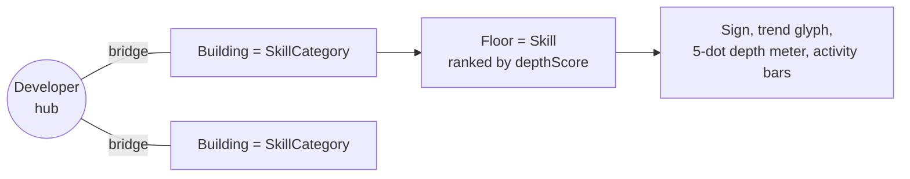

| Visual | Graph data |
|---|---|
| **Hub** | The `Developer` |
| **Building** on a ring | A `SkillCategory` (ring radius grows with the number of categories) |
| **Floor** (top skills, capped) | A `Skill` via `(SkillCategory)-[:CONTAINS]->(Skill)` |
| Floor order | `HAS_SKILL.depth_score`, then depth rank |
| 5-dot depth meter | `novice → familiar → proficient → advanced → expert` |
| Trend badge | `HAS_SKILL.trend` (rising, steady, cooling, dormant) |
| Monitor bars | Monthly activity (last 18 months) |
| **Skill Insights** | Strongest, rising, cooling, thin evidence, and "learn next" from `related` and `implies` |
| **Skill Evidence** | The files that prove a skill (`/api/skills/:slug`) |

Skills are classified by rule (a definitive path such as `Dockerfile` or a real import or call in the added code is strong evidence; a language-only match is weak). Depth blends capped components for volume, breadth, commits, repositories and sustained use, multiplied by an evidence-quality factor. Edges: `HAS_SKILL`, `CO_OCCURS` (from the same commit), `IMPLIES`, `ADJACENT_TO`, `USED_IN`.

| Route | Purpose |
|---|---|
| `GET /api/graph/summary` | Categories, skills and insights for the city |
| `GET /api/graph/regenerate` | Rebuilds the skill graph, streamed over SSE (`area_ready` per building) |
| `GET /api/skills/:slug` | Skill detail with commit-level proof |
| `GET /api/skills/graph`, `/insights`, `/taxonomy` | Skill graph, insights, taxonomy |
| `GET /api/graph/debug-intelligence` | Counts of skills, capabilities, demonstrations, relationships |

---

## 🔌 GitHub MCP server and sync pipeline

Pathway reaches GitHub **only through the official [GitHub MCP server](https://github.com/github/github-mcp-server)**. There is no hand-written GitHub REST client: the backend starts the server as a short-lived Docker container and talks to it over stdio with the MCP client SDK.

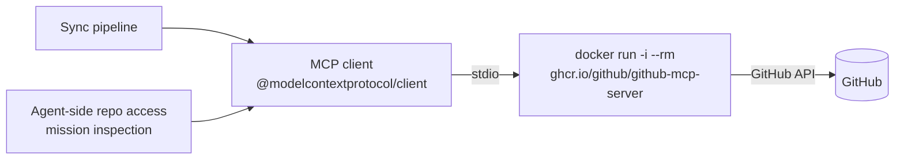

**Read-only tool allow-list.** The container is started with `GITHUB_TOOLS`, so only these tools exist for the session:

| MCP tool | Used for |
|---|---|
| `get_me` | Resolve the signed-in developer |
| `search_repositories` | Discover repositories (pushed within the history window) |
| `list_commits` | Find your commits |
| `get_commit` | Fetch the full patch and per-file diffs |
| `get_file_contents` | README, manifests, config, directory listings; repo inspection at a commit |
| `list_pull_requests` | Pull requests per repository |
| `pull_request_read` | Optional PR detail, reviews and changed files |
| `search_issues` | Issues opened and pull requests reviewed |

**Design notes**

- **One file per tool.** The tool wrappers share a single `GithubMcpCall` function, so sync code and agents use the same calls.
- **Token never goes on the command line.** Docker is passed `-e GITHUB_PERSONAL_ACCESS_TOKEN` and the value comes from the process environment.
- **Two entry points.** `syncDeveloperGithubData` opens one session for a whole sync (image tag `latest`). `withGithubMcp(token, tools, fn)` opens a scoped session with its own tool list for agent-side repository access and pins `v1.11.0`.
- **SHA-aware file reads.** A 40-hex commit id is moved to the `sha` argument automatically.

### Sync pipeline

Incremental, rate-limit aware, idempotent (every write is a `MERGE`).

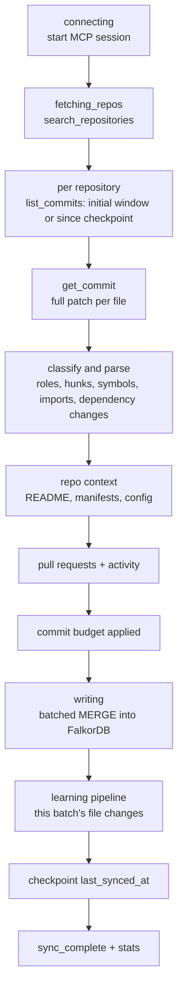

**What is extracted from every commit**

| Evidence | Examples |
|---|---|
| File role | `source`, `test`, `migration`, `schema`, `style`, `markup`, `config`, `infra`, `dependency_manifest` |
| Diff structure | Hunks, touched scopes, additions and deletions, renames |
| Code signals | Symbols added, modified, removed; imports added and removed; relative imports; comment lines; max indent depth; counted signals such as `caching`, `queues_workers`, `llm_ai`, `graph_db` |
| Dependencies | Added, removed and changed packages from `package.json`, `pyproject.toml`, `requirements.txt`, `go.mod`, `Cargo.toml`, `Gemfile`, `composer.json` |
| Commit | Subject, conventional type and scope, breaking and revert flags, PR number |
| Repo context | README, manifest and config files, root entries, tooling flags, dependency map (refreshed every 7 days by default) |

Lockfiles, `node_modules/`, `dist/`, generated and minified files, images and docs are filtered out. Stored patches are capped (60k chars of diff and 40k of added code per file by default).

**What sync writes**

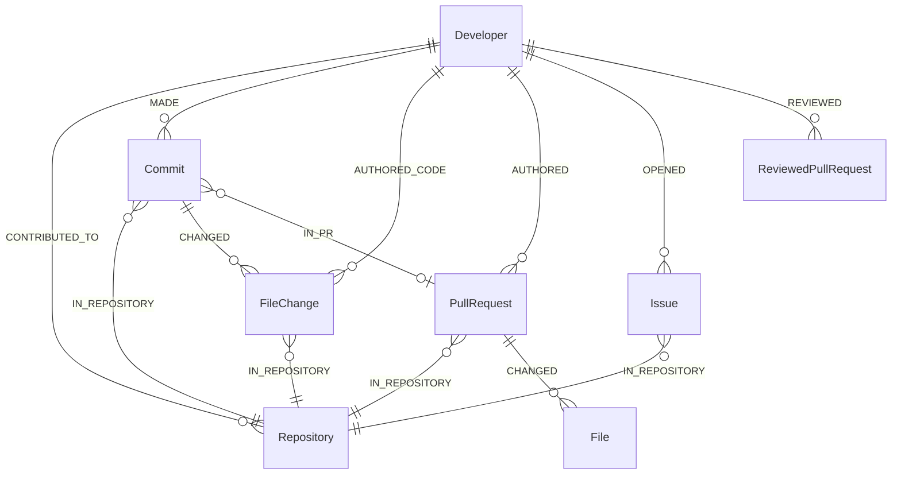

**Built for real accounts**

- **Incremental.** A per-repository `last_synced_at` checkpoint plus a 7-day overlap window.
- **Budgeted onboarding.** First sync is capped (60 commits per repository, 400 total, 365 days by default), newest first.
- **Rate-limit aware.** Each call retries up to 3 times with exponential backoff and jitter. On a GitHub rate limit the sync stops retrying, skips remaining calls and reports `rateLimited`. Repositories whose discovery or commits failed are not checkpointed, so the next run picks them up.
- **Resilient enrichment.** The learning stage is separate: if the LLM provider is down, the GitHub data is still saved and a `learning_failed` event is emitted. Commit enrichment is written only after learning succeeds.
- **Bounded concurrency.** Repositories, commits and PR details use configurable concurrency.
- **Clean graph.** Evidence outside the history window, excluded repositories (`GITHUB_EXCLUDE_REPOS`) and inactive repository links are pruned.
- **Safe Cypher.** Labels and properties interpolated into index queries pass an identifier allow-list.
- **Run stats.** Repositories, commits discovered and processed, files changed, source and test files, patches stored, hunks, symbols, imports, dependency changes, retries, and final graph node and relationship counts.

Progress events (`connecting`, `repos_found`, `repo_started`, `commits_discovered`, `sync_progress`, `writing`, `learning_complete`, `learning_failed`, `rate_limited`, `sync_complete`, and others) are streamed to the UI.

---

## 🧱 Tech stack

| Layer | Technology |
|---|---|
| Graph database | **FalkorDB** (Docker), Cypher, built-in graph algorithms |
| Backend | Node.js, TypeScript (ESM) |
| AI | LLM agents on **Cerebras** (default) and **NVIDIA** (gpt-oss), with validator and repair loops, a shared rate governor and a circuit breaker |
| Frontend | **React**, **React Three Fiber** + drei (3D Skill City) |
| API | Express (REST + SSE) |
| GitHub access | **GitHub MCP server** (Docker, stdio) via the Model Context Protocol client SDK |
| Verification | Platform-generated tests run in a Daytona sandbox |
| Infra | Docker |

---

## 🚀 Setup instructions

### Prerequisites

- **Node.js** 20+ and **npm** (or pnpm / yarn)
- **Docker** (runs FalkorDB **and** the GitHub MCP server that the backend starts on demand)
- A **GitHub OAuth app** and a **personal access token**
- A **Cerebras API key** (used by the depth, goal, mission and chat agents); an **NVIDIA API key** is optional
- A **Daytona API key** (evaluation sandbox for mission tests)

### 1. Clone

```bash
git clone https://github.com/AymaanPathan/pathway.io.git
cd pathway.io
```

### 2. Start FalkorDB with Docker

FalkorDB requires Redis 8.0+, which is already bundled in the official `falkordb/falkordb` image. See the [FalkorDB Getting Started guide](https://docs.falkordb.com/getting-started).

**Quickest start** (no authentication, data is lost when the container is removed):

```bash
docker run -p 6379:6379 -p 3000:3000 --rm falkordb/falkordb:latest
```

**Recommended: with a persistent volume:**

```bash
docker volume create falkordb_data

docker run -d --name falkordb \
  -v falkordb_data:/var/lib/falkordb/data \
  -p 6379:6379 -p 3000:3000 \
  falkordb/falkordb:latest
```

| Port | Purpose |
|---|---|
| `6379` | FalkorDB (Redis protocol), used by the backend |
| `3000` | Built-in FalkorDB Browser at http://localhost:3000 |

> If port `3000` clashes with another service, map the browser elsewhere, e.g. `-p 3001:3000`.

Verify:

```bash
docker exec -it falkordb redis-cli PING
# PONG
```

**Pull the GitHub MCP server images.** The backend launches them with `docker run`. The sync session uses the `latest` tag and the scoped agent helper pins `v1.11.0`:

```bash
docker pull ghcr.io/github/github-mcp-server:latest
docker pull ghcr.io/github/github-mcp-server:v1.11.0
```

<details>
<summary><b>Optional: password-protect FalkorDB</b></summary>

```bash
docker run -d --name falkordb \
  -v falkordb_data:/var/lib/falkordb/data \
  -p 6379:6379 -p 3000:3000 \
  -e REDIS_ARGS="--requirepass yourpassword" \
  falkordb/falkordb:latest
```

Then set the same password in your backend `.env`.
</details>

**Or with Docker Compose:**

```yaml
# docker-compose.yml
services:
  falkordb:
    image: falkordb/falkordb:latest
    container_name: falkordb
    ports:
      - "6379:6379"
      - "3000:3000"
    volumes:
      - falkordb_data:/var/lib/falkordb/data
    restart: unless-stopped

volumes:
  falkordb_data:
```

```bash
docker compose up -d
```

### 3. Configure the backend

```bash
cd backend
cp .env.example .env
```

```env
# --- GitHub ---
GITHUB_PERSONAL_ACCESS_TOKEN=ghp_xxx
GITHUB_CLIENT_ID=your_oauth_client_id
GITHUB_CLIENT_SECRET=your_oauth_client_secret
GITHUB_OAUTH_CALLBACK_URL=http://localhost:4000/auth/github/callback
GITHUB_EXCLUDE_REPOS=            # optional: repositories to skip during analysis

# --- Auth and URLs ---
SESSION_JWT_SECRET=change_me_to_a_long_random_string
FRONTEND_URL=http://localhost:5173

# --- FalkorDB ---
FALKORDB_URL=redis://localhost:6379
# with a password: redis://:yourpassword@localhost:6379

# --- LLM providers ---
CEREBRAS_API_KEY=csk_xxx
NVIDIA_API_KEY=nvapi_xxx         # optional
# NVIDIA_MODEL=openai/gpt-oss-20b

# --- Evaluation sandbox ---
DAYTONA_API_KEY=your_daytona_key

# --- Depth Analyzer LLM throttling ---
DEPTH_LLM_CONCURRENCY=2          # parallel LLM calls
DEPTH_LLM_TPM=60000              # tokens-per-minute budget for the shared governor
DEPTH_LLM_RETRIES=1              # retries per failed call
DEPTH_LLM_BREAKER=6              # consecutive failures before the circuit breaker opens
```

| Variable | Purpose |
|---|---|
| `GITHUB_CLIENT_ID`, `GITHUB_CLIENT_SECRET`, `GITHUB_OAUTH_CALLBACK_URL` | GitHub OAuth app used for sign-in (create one under **GitHub, Settings, Developer settings, OAuth Apps**) |
| `GITHUB_PERSONAL_ACCESS_TOKEN` | Token handed to the GitHub MCP server (read-only tools) |
| `GITHUB_EXCLUDE_REPOS` | Optional list of repositories to leave out |
| `SESSION_JWT_SECRET` | Secret used to sign session tokens |
| `FRONTEND_URL` | Frontend origin (CORS and OAuth redirects) |
| `FALKORDB_URL` | Connection URL for FalkorDB |
| `CEREBRAS_API_KEY`, `NVIDIA_API_KEY`, `NVIDIA_MODEL` | LLM providers for the agents |
| `DAYTONA_API_KEY` | Daytona sandbox where generated tests run |
| `DEPTH_LLM_*` | Rate limiting and failure handling for the Depth Analyzer |

<details>
<summary><b>Optional: agent and analyzer tuning</b></summary>

| Variable | Default | Purpose |
|---|---|---|
| `DEPTH_LLM_MODEL` | Cerebras default | Model for the depth agent (only known Cerebras models are honoured unless `DEPTH_LLM_ALLOW_ANY_MODEL=true`) |
| `DEPTH_LLM_TIMEOUT_MS` | `45000` | Per-call timeout |
| `DEPTH_LLM_JSON_MODE`, `DEPTH_LLM_THINKING` | `true`, `false` | Request options |
| `DEPTH_JUDGE_CONCURRENCY` | `8` | Topics gathered and judged in parallel |
| `DEPTH_FILE_PAGE_SIZE` | `1000` | Keyset page size when reading file changes |
| `DEPTH_DEMO_LIMIT` | `1500` | Demonstrations preloaded per analysis |
| `DEPTH_TAXONOMY_CACHE_MS` | `15000` | In-process cache for taxonomy reads |
| `LLM_TIMEOUT_MS` | `25000` | Per-request timeout for the goal agent |
| `LLM_MAX_RETRIES` | `1` | Transport retries per request (max 5) |
| `LLM_TOTAL_BUDGET_MS` | `45000` | Total LLM time per goal call including retries |
| `GOAL_DEADLINE_MS` | `55000` | Overall deadline for `planGoal` |
| `TOPIC_CHAT_HARD_MS` | `12000` | Hard timeout per chat LLM call |
| `TOPIC_CHAT_ROUND2` | on | Set `0` to disable the dependent second tool round |
| `MISSION_DEBUG` | off | Set `1` to log every successful mission query (failures always log) |

</details>

<details>
<summary><b>Optional: sync tuning</b></summary>

| Variable | Default | Purpose |
|---|---|---|
| `GITHUB_HISTORY_DAYS` | `365` | How far back to analyze |
| `GITHUB_MAX_INITIAL_COMMITS_PER_REPO` | `60` | First-sync cap per repository |
| `GITHUB_MAX_INITIAL_COMMITS_TOTAL` | `400` | First-sync cap overall |
| `GITHUB_SYNC_OVERLAP_DAYS` | `7` | Overlap window for incremental syncs |
| `GITHUB_CONCURRENCY` | `10` | Repositories processed in parallel |
| `GITHUB_COMMIT_CONCURRENCY` | `12` | Commits fetched in parallel |
| `GITHUB_PAGE_SIZE` | `100` | Page size for listings |
| `GITHUB_FETCH_PRS` | `true` | Fetch pull requests |
| `GITHUB_FETCH_PR_DETAILS` / `GITHUB_FETCH_PR_FILES` | `false` | Extra MCP calls per PR |
| `GITHUB_MAX_PR_DETAILS` | `20` | Cap for PR detail fetches |
| `GITHUB_FETCH_ACTIVITY`, `GITHUB_MAX_ACTIVITY_ITEMS` | `true`, `50` | Issues opened and pull requests reviewed |
| `GITHUB_MAX_PATCH_CHARS` | `60000` | Diff size stored per file |
| `GITHUB_MAX_ADDED_CODE_CHARS` | `40000` | Added-code size stored per file |
| `GITHUB_REPO_CONTEXT_REFRESH_DAYS` | `7` | How often README and manifests are refreshed |
| `GITHUB_REPAIR_INCOMPLETE_FILECHANGES` | `false` | Re-fetch commits whose file changes are stale |
| `FALKORDB_BATCH_SIZE` | `500` | Rows per batched write |
| `FALKORDB_FILECHANGE_BATCH_SIZE` | `40` | FileChange rows per write batch |
| `GITHUB_SYNC_DEBUG` | `false` | Verbose sync logging |

</details>

### 4. Install and run the backend

```bash
npm install
npm run dev
```

Backend: **http://localhost:4000**. On first run it creates indexes (including the full-text indexes) and seeds the capability taxonomy, technique specs and safeguards.

### 5. Run the frontend

```bash
cd ../frontend
npm install
npm run dev
```

Frontend: **http://localhost:5173**. The 3D Skill City uses `three`, `@react-three/fiber` and `@react-three/drei`:

```bash
npm install three @react-three/fiber @react-three/drei
```

### 6. Try the full learning loop

1. Sign in with GitHub and sync your repositories
2. Run the **analysis** (the Depth Analyzer discovers topics, judges them, writes `DepthAssessment`s and `KNOWS_TOPIC` edges, then refreshes PageRank, betweenness, communities and WCC)
3. Look at **what you know**: the Journey view and the 3D Skill City
4. Ask **"what should I learn next?"** in chat, or set a **goal** on the Goal page
5. Read your **learn-next recommendation** and the reason it was chosen, then open your **practice mission**
6. Implement it, push your branch, and let the sandbox verify it
7. Re-grade the focus topic and watch your frontier move forward


### 7. Reproduce the recommendation on your own data

Open the FalkorDB Browser at http://localhost:3000 and run, with your `Developer.id` and a topic slug from your profile:

```cypher
// what you know about the topic, and what backs it
MATCH (:Developer {id: $dev})-[:ASSESSED]->(a:DepthAssessment {topic_slug: $slug})
OPTIONAL MATCH (a)-[b:BACKED_BY]->(x)
RETURN a.level, a.score, a.confidence, a.authenticity, a.rationale, a.stale,
       labels(x)[0] AS kind, b.ref AS ref, coalesce(x.path, x.technique) AS evidence

// what the topic rests on, and your level in each prerequisite
MATCH path = (t:Topic {slug: $slug})-[:BUILDS_ON*1..3]->(f:Topic)
WITH f, min(length(path)) AS hops
OPTIONAL MATCH (:Developer {id: $dev})-[k:KNOWS_TOPIC]->(f)
RETURN f.slug AS prerequisite, hops, coalesce(k.level, "none") AS your_level

// the capabilities mapped to the topic and your demonstrations for each
MATCH (t:Topic {slug: $slug})-[m:MAPS_TO]->(c:Capability)
OPTIONAL MATCH (:Developer {id: $dev})-[:DEMONSTRATED]->(x:Demonstration)-[:OF_CAPABILITY]->(c)
RETURN c.id, m.weight, m.reason, count(DISTINCT x) AS demonstrations

// the practice mission built from the recommendation, with the stored query trace
MATCH (:Developer {id: $dev})-[:ASSIGNED]->(m:Mission {focus_slug: $slug})
RETURN m.status, m.verification_state, m.explanation_json
```

The `explanation_json` on each Mission contains the real queries that loaded the saved recommendation, with parameters and row counts.

---

## 🛠️ Troubleshooting

| Problem | Fix |
|---|---|
| `ECONNREFUSED 6379` | FalkorDB is not running: `docker ps`, then `docker start falkordb` |
| MCP connection fails or sync hangs at `connecting` | The backend starts the GitHub MCP server with `docker run`. Make sure Docker is running and the images are pulled (see step 2) |
| Sync stops with `rateLimited` | GitHub's rate limit was hit. Progress is checkpointed, so rerun later. Lower `GITHUB_MAX_INITIAL_COMMITS_*` or `GITHUB_COMMIT_CONCURRENCY` |
| `learning_failed` after sync | The LLM provider failed during enrichment. GitHub data is already saved; rerun the sync |
| Depth analysis reports `llmCircuitOpen` | Repeated LLM failures opened the breaker for 30 seconds. Topics fall back to counts-only estimates (level capped at `proficient`, confidence `low`) until the provider recovers; re-run with `force` |
| Metrics status `empty_graph` | Fewer than 2 topics or no `BUILDS_ON` / `RELATED_TOPIC` edges yet: re-run the analysis, or `relinkTopicTaxonomy` |
| Frontier is empty or recommendations look generic | Too few prerequisite edges or too little evidence. Sync more repositories, re-run the analysis and check metrics status |
| Communities show only "Standalone" | Not enough `RELATED_TOPIC` links; the tools fall back to `Topic.cluster_id` |
| `needs_clarification` on a goal | The wording could not be tied reliably to any `Topic`. Name a topic from your graph |
| `needs_evidence` on a goal | No readable, non-test code is linked to that topic or its neighbourhood. Sync or analyse the relevant repositories |
| `llm_unavailable` | Set `CEREBRAS_API_KEY`; Pathway will not invent a recommendation or mission without an LLM |
| `generation_failed` | Check `failure.stage`: `transport` means the provider failed after retries; `validation` means all repair attempts were rejected (see the rejection notes in the logs) |
| "N of M rows matched nothing" in logs | A `MATCH` in a batch write found no node; parent nodes must be written first. Strict writes abort before stale cleanup |
| Assessment marked `stale` | A mission changed the topic's evidence. Re-grade it with `reanalyzeTopicDepth` |
| Port 3000 already in use | Remap the FalkorDB Browser with `-p 3001:3000` |
| Tool timed out | Chat tools are capped at 20 s: check graph size and DB health |

---

## ⚖️ Limitations

- **Detectors are heuristics.** Capabilities and demonstrations come from deterministic patterns over added lines. A match does not prove the code is good, and good work written in an unrecognised way is not seen. That means a topic you know well may appear as a gap.
- **Topics are model-discovered.** They are validated against your evidence, but the topic list, domains and `BUILDS_ON` edges are model proposals with stored rationales and confidences, not curated truth. Edges are labelled by `basis`, so treat the "learn next" order as a well-grounded suggestion rather than a fixed curriculum.
- **Levels are Pathway's own thresholds**, not an industry standard. Confidence describes the evidence, not the skill.
- **Missing evidence means "not seen".** Work outside GitHub, in unsynced private repositories, or outside the history window is not represented, and learning you did elsewhere will not show up until you build with it.
- **The Goal Agent decides, not the graph.** The graph retrieves, ranks and validates; Personalized PageRank orders context and is not a recommendation score. Only the chosen recommendation is saved, so alternatives are not recorded beyond the one the agent weighed.
- **Mission verification** trusts the diff-check and CI state; a single mission never claims more than `working`-level evidence.

---

## 💡 Design principles

1. **Start from what you know**: every recommendation is anchored to your own code, not a generic roadmap
2. **Graph for structure, LLM for judgment**: ordering, readiness and ranks come from algorithms; classification and writing come from models
3. **Topics order the learning, capabilities prove it**: `BUILDS_ON` says what is next, verified demonstrations say what is done
4. **Explain every "next"**: each recommendation carries the path, the prerequisite reasons and the gap that put it first
5. **Ground every claim**: verbatim code quotes, cited refs, gap probes, stored query traces
6. **Validate model output against the graph**: unknown slugs, ids, files and quotes are rejected, not trusted
7. **Learning is proven by building**: platform tests run against your code, and completion needs verified criteria plus acceptable CI
8. **Evidence over assertion**: only code-backed edges count; inferred edges are labelled and never satisfy a prerequisite
9. **Keep four ideas apart**: proficiency, confidence, graph importance and gap priority never share a field
10. **Self-describing tools**: adding a chat graph tool is a single declaration

---

<div align="center">

### ⭐ If Pathway helps you decide what to learn next, please star the repo!

</div>
